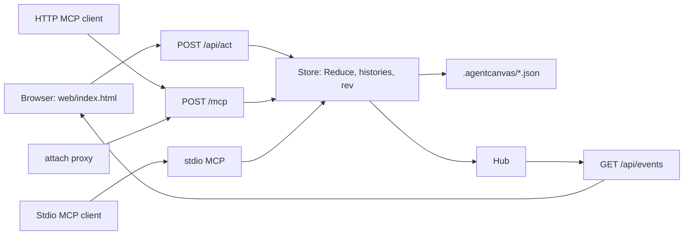
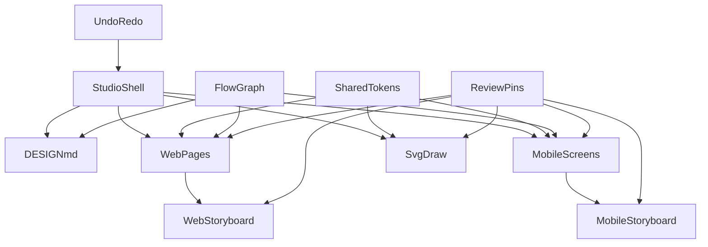

# AgentCanvas — final requirements and build spec

This document is the single source of truth for building AgentCanvas. It is written for coding agents. Every section is normative unless it is marked *Guidance*. When two sections seem to conflict, the more specific one wins (a table of values beats prose).

It replaces [docs/ui/requeriments.md](ui/requeriments.md) (the "UI spec") and [docs/server/requeriments-server.md](server/requeriments-server.md) (the "server spec"). Where this document and either of those disagree, this document wins. Sections carried over from the UI spec are verbatim unless a **Changed from UI spec** note says otherwise.

## 0. How to use this document

- **Read §1–§7 and §12 fully before writing code.** They define constraints, the data model, tokens, the seed project, and the sync protocol. Everything else depends on them.
- **Build in the milestone order in §16.** Each milestone has a "done when" list. Do not start the next milestone until the current one is verified in a real browser (and, from M11, with a real MCP client).
- **Every numbered requirement in §3 has acceptance criteria in §17.** Treat §17 as the test plan. A requirement is not done until its criteria pass.
- **Do not add anything listed in §19 (out of scope) or invent new libraries.** If something is ambiguous, pick the simplest behavior that satisfies §17 and leave a short `// SPEC:` comment at the decision point in the code (Go or JS).
- Terms in **bold** in §2 are used consistently throughout; use the same names for variables, types, components, MCP tools, and UI labels.

## 1. Job to be done

A designer uses one page to **create** and **improve** UI and UX: write intent, map connected flows, edit web pages and mobile screens, draw, preview as a user, mark issues, fix, repeat.

The product is a studio, not a mockup. Every visible control must work; nothing is decorative placeholder UI.

Any coding agent that speaks MCP drives the **same** canvas the designer sees. The designer runs one binary in a repository; the browser and every connected agent read and change one project, and each sees the other's changes live. An agent that cannot see the browser must still be able to learn the tool list, read the project, change it, and read back what changed. The server implements the public MCP protocol only: no vendor-specific headers, prompts, or config formats are baked into the handlers.

## 2. Glossary

| Term | Meaning |
|---|---|
| **Project** | The whole persisted design state: tokens, flows, nodes, edges, draw shapes, doc markdown, pins. One per **project directory** (§12.1). |
| **Tab** | Top-level mode: `web`, `story`, `draw`, `doc`. |
| **Channel** | `web` or `mobile`. Flows, nodes, and edges belong to exactly one channel. |
| **Flow** | A named group of nodes with one start node. Example: "Marketing", "Onboarding". |
| **Node** | A **page** (web channel) or a **screen** (mobile channel). |
| **Edge** | A directed connection between two nodes in the same channel. May cross flows. |
| **Cross-flow edge** | An edge whose `fromId` and `toId` live in different flows. Always rendered in the accent color. |
| **Block** | A section inside a web page (Nav, Hero, Features, Quote, CTA band, Footer). |
| **Child** | A nested, individually selectable item inside a block (a nav link, a feature card, a footer link). |
| **Archetype** | The template a mobile screen is built from (Title, Photo, Quote, CTA, Split). |
| **Hotspot** | A tappable rectangle on a mobile screen that targets a node. |
| **Page view** | Editing surface for one node. |
| **Storyboard view** | Map of all flows in the current channel with their edges. |
| **Preview** (web) / **Play** (mobile) | Chrome-less walkthrough that follows edges. |
| **Pin** | A numbered review annotation (Issue, Suggestion, Question). |
| **Tokens** | Shared named values for color, type, and space. |
| **Inspector** | Right panel. Tabs: Content, Design, Review. Shows edge properties when an edge is selected. |
| **Outline** | Left panel tree: flows → nodes → blocks → children. |
| **Palette** | Left panel insert list (blocks, archetypes, draw tools). |
| **Specs overlay** | Red-line style labels showing px sizes on the selected object. |
| **Store** | The single in-process Go owner of the project, the shared view state, the undo histories, and the **rev**. |
| **Action** | A named, JSON-encoded intent (`{type, payload}`) applied by the Store's reducer. The browser and MCP tools both send actions. |
| **Rev** | A counter the Store increments on every committed action. Only increases. |
| **Shared view state** | The part of the UI state held by the Store so every browser and agent agree on it (§6.2). |
| **Agent** | Any MCP client (over HTTP, `--stdio`, or `attach`). |
| **Skill** | A folder with `SKILL.md` and `skill.json` that the binary stores and serves as text. A skill never registers tools or runs code. |
| **Built-in skill** | The `agentcanvas` skill embedded in the binary that teaches agents how to drive the studio. |

## 3. Requirements checklist

Everything below is in scope. The implementation must cover each item. Acceptance criteria for each number are in §17.

### 3.1 Create three things (plus Doc)

1. **Design a web page** — multi-page web UI builder with real visual editing.
2. **Design a mobile story-flow app** — phone-frame screens in named flows.
3. **Design an SVG diagram / draw** — freehand + shapes on a native SVG canvas.
4. **DESIGN.md space** — first-class Doc tab to write and export `DESIGN.md`.

### 3.2 Storyboards that connect different flows (web and mobile)

5. Web and mobile each have **named flows** (not one linear strip).
6. **Page view** edits one page/screen; **Storyboard view** shows all flows as connected thumbnails.
7. Designer can **connect different flows** (cross-flow edges, e.g. Onboarding last screen → Home, Shop → Cart).
8. One node may have **several outbound edges** (branches: CTA, Skip, Error, Back).
9. Preview/Play **follows edges**, not array order, including jumps into another flow.
10. Create, rename, and delete flows, pages, and screens from Outline.

### 3.3 Improve UI and UX (designer loop)

11. **Shared tokens** — colors `paper, ink, muted, accent, wash, line`; type `xs sm md lg xl display`; space `0 4 8 16 24 32 48 64`.
12. **Craft inspector** — type role, weight, alignment, padding/gap from the space scale, fill/ink from tokens (not only copy + hex).
13. **Undo / redo** — per-document history (50 steps), `Cmd/Ctrl+Z` and `Cmd/Ctrl+Shift+Z`.
14. **Preview / Play** — hide studio chrome; `Esc` exits. Web: current page at current breakpoint, in-page links navigate via edges. Mobile: start at flow `startId`, taps follow edges.
15. **Breakpoints (web)** — Desktop 1280, Tablet 768, Phone 390. Nav collapses, feature grid 3→2→1, type steps down.
16. **Outline** — flows → pages/screens → blocks → nested children. Click to select what the canvas would miss.
17. **Nested select** — e.g. one feature card or one nav link, not only the whole block.
18. **Specs overlay** — selected object shows type size and padding in px.
19. **12-column overlay** on the web page frame (toggle).
20. **8px snap** in draw (hold Alt to disable).
21. **Contrast check** — flag fill vs ink below AA for body text.
22. **Tap-target check** — flag mobile CTAs and hotspots under 44px.
23. **Keyboard** — `Esc` deselect/exit preview, `Delete`/`Backspace` remove, `Cmd/Ctrl+D` duplicate, `Cmd/Ctrl+Z` undo, `Cmd/Ctrl+Shift+Z` redo, `Space` (held) pan in draw.

### 3.4 Annotations

24. Figma-style **numbered pins** on web pages, mobile screens, storyboard nodes, and the SVG canvas.
25. Pin kinds: **Issue | Suggestion | Question**.
26. Annotate mode: click to place, type note, Enter to save; drag to move; Resolve / Delete.
27. Notes list with filters (kind, Open/Resolved) and jump-to-pin.
28. **Show pins** can stay on while designing. Top bar **open-issue count**.
29. Pins persist with the project. They are **not** included in HTML/SVG exports; they **are** listed in the DESIGN.md appendix.

### 3.5 Starter project (never empty)

30. Seed slightly **flawed** UI so there is something to improve (tight type, one low-contrast CTA, one too-small mobile CTA).
31. Two **web** flows already connected: Marketing (Home → Shop) **cross** into Checkout (Cart → Confirm), plus two Issue pins.
32. Two **mobile** flows already connected: Onboarding (3 screens, last CTA **cross** to Home) plus Account.
33. DESIGN.md seeded with Intent, Users, Principles, Decisions for that starter product.

### 3.6 One binary

34. **Single self-contained binary** — the Go binary embeds the React UI and every asset it loads (React, Babel, Tailwind, fonts); the studio works with no internet connection.
35. **Local server** — binds loopback, scans for a free port, and prints the UI URL, the MCP URL, and a note that any streamable-HTTP MCP client can use it.
36. **Project per directory** — the project lives in `./.agentcanvas/` of the directory the binary was started in (overridable with `--project`); one process serves one project.

### 3.7 Agents

37. **MCP transports** — streamable HTTP at `/mcp`, `serve --stdio`, and `attach` (a stdio proxy to an already running server). All three reach the same Store.
38. **Live sync** — an agent's change appears in every open browser without reload; a designer's change is visible to the next agent read; undo/redo are shared.
39. **`get_canvas` is the screen substitute** — an agent can design from its JSON without a screenshot; refused actions explain the invariant and what to call next.
40. **Discovery** — `initialize` instructions, `tools/list`, `GET /guide`, `GET /mcp.json`, and the `agentcanvas://guide` resource.

### 3.8 Skills

41. **Skill store** — install, list, and remove SKILL.md packages from the CLI and MCP; installs are validated and all-or-nothing.
42. **Built-in skill** — the binary ships an `agentcanvas` skill that is always listed and cannot be removed.
43. **Export into agent folders** — `skills export` copies a skill into any folder (`--dir`) or a known agent folder (`--agent claude|codex`, project or `--global`).
44. **Skills panel** — the studio shows installed skills and renders their `SKILL.md`, read-only.

## 4. Architecture and hard constraints

### 4.1 Deliverables and repository layout

One Go module that builds one binary, `agent-canvas`. Layout:

| path | contents |
|---|---|
| `cmd/agent-canvas/main.go` | CLI entry; calls `internal/cli`. Replaces the IDE stub in `main.go` at the repo root (delete it). |
| `internal/cli` | `serve`, `serve --stdio`, `attach`, `skills list\|install\|remove\|export`, `version`, `--help` (§15). |
| `internal/server` | mux, port scan, Origin checks, `/healthz`, `/api/*`, `/assets/*`, `/`, `/guide`, `/mcp.json`, `/mcp` mount. |
| `internal/hub` | SSE subscriber registry; buffered channel per subscriber; drops slow clients. |
| `internal/studio` | §6 types, `MakeSeed()` (§7), `Reduce(state, action)` with every §6.1 invariant, histories (§11.3), checks (§9), `laneOrder` (§9.5), persistence (§12.1). Pure functions except the Store wrapper. |
| `internal/export` | §11.4 / §11.5 generators from project data. |
| `internal/mcp` | Tool wrappers over the Store, initialize instructions, `agentcanvas://guide`, HTTP and stdio transports. |
| `internal/skills` | Validate, install, list, remove, export; the embedded built-in skill. |
| `web/index.html` | The whole studio UI: one hand-written HTML file with one `<script type="text/babel" data-presets="react">` block. |
| `web/vendor/` | Pinned third-party assets (§4.3) and `VERSIONS` (name, version, source URL, sha256 per file). |
| `skills/agentcanvas/` | `SKILL.md` + `skill.json` of the built-in skill, embedded with `go:embed`. |
| `Makefile` | `vendor` (fetch + verify pinned assets), `test`, `build`, `release` (six targets). |

`go.mod` keeps `module agentcanvas` and declares `go 1.24` or later.

### 4.2 Go constraints

- Standard library `net/http` with Go 1.22+ method patterns (`GET /api/state`). No router library.
- MCP: `github.com/modelcontextprotocol/go-sdk`, version pinned in `go.mod` (written against v1.x). Streamable HTTP runs with `Stateless: true` so any client can connect without a sticky session; the SDK negotiates the protocol version. MCP session state stays empty; tool handlers close over the Store.
- No other third-party Go dependencies without a `// SPEC:` justification. No templ, no Datastar, no CGO (`CGO_ENABLED=0`).
- `web/` and `skills/agentcanvas/` are embedded with `go:embed`. The binary needs no files next to it.

### 4.3 Frontend constraints

- Exactly one UI source file: `web/index.html`. No npm, no bundler, no `package.json`, no extra `.js` or `.css` files of our own. JSX is compiled in the browser by Babel standalone, as in the UI spec.
- Load these and nothing else, all served by the binary from `/assets/` (vendored in `web/vendor/`, pinned to these versions):

```html
<link rel="stylesheet" href="/assets/fonts.css"> <!-- @font-face for the vendored woff2 files below -->
<script src="/assets/react@18.3.1/react.production.min.js"></script>
<script src="/assets/react-dom@18.3.1/react-dom.production.min.js"></script>
<script src="/assets/babel-standalone@7.24.7/babel.min.js"></script>
<script src="/assets/tailwindcss-play@3.4/tailwind.js"></script>
```

  - Fonts: Inter 400/500/600 and Fraunces (opsz 9–144, weights 400/500/600) as woff2, latin subset. `fonts.css` is a vendored file in `web/vendor/`, not app code.
  - `serve --dev` serves the React **development** UMD builds instead (same paths with `.development.js`) and reads `web/` from disk instead of the embedded copy, so editing `index.html` only needs a browser reload.
  - The page must make **no** request to any host other than the server it was loaded from.
- Application code lives in one `<script type="text/babel" data-presets="react">` block.
- Tailwind config is an inline `<script>tailwind.config = {...}</script>` placed **after** the Tailwind script and **before** the Babel script. Extend `fontFamily.ui` = Inter, `fontFamily.serif` = Fraunces, and the six token colors as static Tailwind colors (`paper`, `ink`, `muted`, `accent`, `wash`, `line`) for **chrome only**.
- **No canvas libraries** (no Konva, Fabric, Rough, D3). Draw is native SVG. Markdown rendering is an in-file function.
- **Dynamic colors use inline `style={{}}`**, never dynamic Tailwind class names (the play runtime cannot see them). Static chrome classes are fine.
- React 18 with hooks only. No class components except the one error boundary (§11.6), no external state library.
- Must run without console errors or React warnings in Chrome stable (checked with `serve --dev`).
- Must stay responsive with the seed project: no interaction may take longer than 100 ms on a 2020 laptop. Avoid re-rendering the whole canvas on each keystroke (memoize block components by node/block identity; the Store keeps unchanged objects structurally equal so the client can reuse them).

### 4.4 Architecture



- **One Store, two doors.** `/api/act` and every MCP tool call the same `studio.Reduce`. There is no second reducer in JS: the browser renders what the Store sends.
- After each committed action the Store increments `rev`, schedules a save, and publishes the new state to the hub.

### 4.5 Runtime and network

- Bind `127.0.0.1` only. Start at port `47321`; if taken, try the next 20 ports (`47322`–`47341`), then exit with code `2`. `--port N` tries only `N`.
- On start, print exactly three lines: the UI URL, the MCP URL, and `Any streamable-HTTP MCP client can connect to the MCP URL; stdio clients can run "agent-canvas attach".`
- `--open` opens the UI URL in the default browser.
- No auth in this version; loopback is the boundary. Every `/api/*` and `/mcp` request that carries an `Origin` header must have a loopback origin (`http://127.0.0.1:*`, `http://localhost:*`), else `403` (DNS-rebinding guard). CORS headers are sent on `/mcp` only, for loopback origins.
- Graceful shutdown on SIGINT/SIGTERM: flush pending saves, close SSE streams, remove `server.json`.

**Changed from UI spec:** §4 (single `index.html` at the repo root, `file://`, CDN URLs, "no Go") is replaced by this section. **Changed from server spec:** templ, Datastar, Tailwind CLI, and `air` are dropped; the UI is React.

## 5. Tokens and scales

Tokens are project data (editable, undoable, persisted). The defaults below are the seed values.

### 5.1 Colors (`tokens.colors`)

| key | default | role |
|---|---|---|
| `paper` | `#F4EFE6` | default page/screen background |
| `ink` | `#1C1B19` | default text |
| `muted` | `#6B665C` | secondary text |
| `accent` | `#D8432A` | vermillion: CTAs, selection, pins, cross-flow edges |
| `wash` | `#E9E2D4` | alternate section background |
| `line` | `#CFC6B5` | borders, dividers |

Any block/screen field typed `ColorKey` holds one of these six keys, never a hex. Resolve with `tokens.colors[key]` at render time. The Design inspector offers a color input per token so the designer edits the hex once and everything updates.

### 5.2 Type (`tokens.type`)

| key | size px | line-height px | default weight | family |
|---|---|---|---|---|
| `xs` | 12 | 16 | 400 | serif |
| `sm` | 14 | 20 | 400 | serif |
| `md` | 17 | 26 | 400 | serif |
| `lg` | 22 | 30 | 500 | serif |
| `xl` | 32 | 38 | 500 | serif |
| `display` | 52 | 56 | 600 | serif |

- Order for stepping: `xs < sm < md < lg < xl < display`. `stepDown(role, n)` moves `n` steps toward `xs` and clamps.
- Allowed weights: `400 | 500 | 600`.
- Designed content uses the serif family. Studio chrome uses the `ui` family. Never mix.

### 5.3 Space (`tokens.space`)

`[0, 4, 8, 16, 24, 32, 48, 64]` in px. Fields typed `SpaceIdx` hold an **index** 0–7, not a px value. The inspector shows a segmented control labeled with the px values.

### 5.4 Breakpoints (constant, not editable)

| name | frame width px | columns in Features | nav | type step-down |
|---|---|---|---|---|
| `desktop` | 1280 | 3 | inline links | 0 |
| `tablet` | 768 | 2 | inline links | 1 for `display` and `xl` only |
| `phone` | 390 | 1 | collapsed to a "Menu" toggle | 1 for all roles ≥ `lg`; also padding index −1 (min index 3 = 16px) |

### 5.5 Chrome palette (constant)

Studio UI uses charcoal tools on warm paper: toolbars `#232220` with `#F4EFE6` text, panels `#FBF8F2`, hairlines `#DDD5C4`, selection and focus rings `#D8432A`. Pins and cross-flow edges always use `#D8432A` regardless of the project's `accent` token.

## 6. Data model

Types are written in TypeScript syntax for precision. They are normative for **both** sides: Go structs in `internal/studio` use JSON tags that match these field names exactly, and the JSON on the wire and on disk is this shape. All ids are strings from `uid()` (8 chars, base36), generated **by the Store** when an action creates something. Seed data uses readable ids (`pg_home`) so tests can reference them.

```ts
type Channel = 'web' | 'mobile';
type Tab = 'web' | 'story' | 'draw' | 'doc';
type ColorKey = 'paper' | 'ink' | 'muted' | 'accent' | 'wash' | 'line';
type TypeKey = 'xs' | 'sm' | 'md' | 'lg' | 'xl' | 'display';
type SpaceIdx = 0 | 1 | 2 | 3 | 4 | 5 | 6 | 7;
type Weight = 400 | 500 | 600;
type Align = 'left' | 'center';

interface Project {
  version: 1;
  tokens: {
    colors: Record<ColorKey, string>;          // hex
    type: Record<TypeKey, { size: number; lh: number; weight: Weight }>;
    space: number[];                           // fixed length 8
  };
  flows: Flow[];
  nodes: Node[];
  edges: Edge[];
  draw: { shapes: Shape[]; view: { x: number; y: number; zoom: number } };
  doc: { markdown: string };
  pins: Pin[];
  pinCounter: number;                          // last issued pin number
}

interface Flow { id: string; name: string; channel: Channel; startId: string | null }

type Node = WebPage | MobileScreen;

interface WebPage {
  kind: 'page'; id: string; flowId: string; name: string;
  blocks: Block[];
}

interface MobileScreen {
  kind: 'screen'; id: string; flowId: string; name: string;
  archetype: 'title' | 'photo' | 'quote' | 'cta' | 'split';
  layout: 'center' | 'bottom' | 'split';
  fill: ColorKey; ink: ColorKey;
  title: string; body: string;
  typeRole: TypeKey; weight: Weight; align: Align; pad: SpaceIdx; gap: SpaceIdx;
  cta: { label: string; toId: string | null; size: 'sm' | 'md' | 'lg'; fill: ColorKey; ink: ColorKey } | null;
  hotspots: Hotspot[];
}

interface Hotspot { id: string; label: string; x: number; y: number; w: number; h: number; toId: string | null }
// x,y,w,h in screen px (0..390 × 0..844)

interface Edge {
  id: string; fromId: string; toId: string;
  label: string;
  kind: 'primary' | 'alt' | 'back' | 'cross';
}

interface BlockBase {
  id: string; type: Block['type'];
  fill: ColorKey; ink: ColorKey;
  pad: SpaceIdx; gap: SpaceIdx;
  typeRole: TypeKey; weight: Weight; align: Align;
}
interface Link { id: string; label: string; toId: string | null }
interface NavBlock      extends BlockBase { type: 'nav';      brand: string; links: Link[] }
interface HeroBlock     extends BlockBase { type: 'hero';     eyebrow: string; headline: string; body: string; bodyRole: TypeKey; cta: Link; secondary: Link | null }
interface FeaturesBlock extends BlockBase { type: 'features'; heading: string; items: { id: string; title: string; body: string }[] }
interface QuoteBlock    extends BlockBase { type: 'quote';    text: string; cite: string }
interface CtaBlock      extends BlockBase { type: 'cta';      headline: string; body: string; button: Link; buttonFill: ColorKey; buttonInk: ColorKey }
interface FooterBlock   extends BlockBase { type: 'footer';   brand: string; note: string; links: Link[] }
type Block = NavBlock | HeroBlock | FeaturesBlock | QuoteBlock | CtaBlock | FooterBlock;

type Shape =
  | { id: string; type: 'rect';    x: number; y: number; w: number; h: number; stroke: ColorKey; fill: ColorKey | 'none'; sw: number }
  | { id: string; type: 'ellipse'; x: number; y: number; w: number; h: number; stroke: ColorKey; fill: ColorKey | 'none'; sw: number }
  | { id: string; type: 'line';    x1: number; y1: number; x2: number; y2: number; stroke: ColorKey; sw: number }
  | { id: string; type: 'arrow';   x1: number; y1: number; x2: number; y2: number; stroke: ColorKey; sw: number }
  | { id: string; type: 'text';    x: number; y: number; text: string; role: TypeKey; ink: ColorKey }
  | { id: string; type: 'pen';     points: [number, number][]; stroke: ColorKey; sw: number };

interface Pin {
  id: string; n: number;
  kind: 'issue' | 'suggestion' | 'question';
  body: string; resolved: boolean;
  target:
    | { type: 'node';  nodeId: string; blockId?: string }   // page or screen in Page view (fractions of node frame)
    | { type: 'board'; nodeId: string }                     // storyboard thumbnail (fractions of thumbnail)
    | { type: 'draw' };                                     // SVG world coordinates
  x: number; y: number;   // fractions 0..1 for node/board, world px for draw
  createdAt: number;
}
```

### 6.1 Invariants (enforce in reducers)

- `edge.fromId` and `edge.toId` reference nodes of the same channel. `fromId !== toId`. A link whose `toId` is its own node (e.g. the "Shop" nav link on the Shop page) is allowed and does nothing; it produces **no** edge.
- `edge.kind` is `'cross'` **iff** the two nodes are in different flows. Recompute kind on every edge create/retarget; the designer may change kind only among `primary | alt | back` when same-flow, and the UI shows `cross` read-only otherwise.
- At most one edge per `(fromId, toId, label)` triple. Different labels between the same two nodes are allowed (branches).
- Every `Link.toId`, `cta.toId`, `hotspot.toId` that is non-null **must** have a matching edge `{fromId: ownerNodeId, toId, label: link.label}`. Setting a link target creates/updates that edge; clearing it deletes the edge. Deleting an edge in the storyboard clears the matching `toId` on the owning link if one exists.
- Deleting a node deletes its edges (both directions), its pins (`node` and `board` targets), and clears any `toId` pointing to it. If it was the flow's `startId`, set `startId` to the first remaining node in that flow or `null`.
- Deleting a flow deletes its nodes (cascade above). A channel must keep at least one flow; disable delete on the last flow.
- `flow.startId` must belong to that flow.
- `pinCounter` only increases. Deleted numbers are never reused.
- `tokens.space` is always the 8-entry scale; it is displayed but not editable (the designer picks indices).

These invariants are enforced in `internal/studio` only, as pure functions (`setLinkTarget`, `deleteNode`, `deleteFlow`, `upsertEdge`, `deleteEdge`, `addPin`, …). An action that would violate one is refused, leaves the project unchanged, and returns an error naming the invariant (§12.3, §13.4). Each invariant has a Go unit test.

### 6.2 View state

UI state is split in two. Neither part is in the project and neither is undoable.

**Shared view state** — held by the Store, sent to every browser, readable and settable by agents:

```ts
interface SharedView {
  tab: Tab;
  view: { web: 'page' | 'board'; story: 'page' | 'board' };
  breakpoint: 'desktop' | 'tablet' | 'phone';
  currentNodeId: { web: string | null; mobile: string | null };
  selection: Selection;
  preview: boolean;
  showPins: boolean;
  showGrid: boolean;       // 12-column overlay
  showSpecs: boolean;
}
type Selection =
  | null
  | { kind: 'node';  nodeId: string }
  | { kind: 'block'; nodeId: string; blockId: string; childId?: string }
  | { kind: 'hotspot'; nodeId: string; hotspotId: string }
  | { kind: 'edge';  edgeId: string }
  | { kind: 'shape'; shapeId: string }
  | { kind: 'pin';   pinId: string };
```

`tab`, `view`, `breakpoint`, `currentNodeId`, `showPins`, `showGrid`, `showSpecs` are persisted in `.agentcanvas/ui.json` so a restart or reload lands where the designer left off. `selection` and `preview` reset on restart. Because the view is shared, two open browsers show the same tab, page, and selection; this is intended (one process, one canvas).

**Local UI state** — React state in each browser, never sent to the server:

```ts
interface LocalUi {
  annotate: boolean;
  pinKind: Pin['kind'];    // annotate kind picker, remembered for the session
  drawTool: 'select' | 'pan' | 'rect' | 'ellipse' | 'line' | 'arrow' | 'text' | 'pen';
  inspectorTab: 'content' | 'design' | 'review';
  reviewFilter: { kind: 'all' | Pin['kind']; status: 'open' | 'resolved' | 'all' };
  skillsOpen: boolean;     // Skills drawer (§8.8)
  // plus transient gesture state: drags in progress, open popovers, pin drafts,
  // the inline edge-label input, focused text-field drafts, Preview/Play history stack.
}
```

**Changed from UI spec:** ids are generated by the Store; the reducer and invariants live in Go; §6.2 `UiState` is split into `SharedView` and `LocalUi`; `localStorage` is replaced by `ui.json`.

## 7. Seed project (exact content)

The product being designed is **Hearth**, a small handmade-ceramics studio shop. Every id below is stable and used by §17.

### 7.1 Web flows

| flow id | name | startId |
|---|---|---|
| `fl_marketing` | Marketing | `pg_home` |
| `fl_checkout` | Checkout | `pg_cart` |

**`pg_home` — Home** (Marketing). Blocks in order:

1. `bk_home_nav` nav: brand "Hearth"; links `[ln_home_shop "Shop" → pg_shop, ln_home_story "Our story" → null, ln_home_cart "Cart" → pg_cart]`; fill `paper`, ink `ink`, pad 3, gap 4, typeRole `sm`.
2. `bk_home_hero` hero: eyebrow "Studio shop"; headline "Everyday ceramics, fired slowly."; body "Small batches thrown in a converted barn. Each piece carries the mark of the hand that made it."; cta `ln_home_cta "Browse the collection" → pg_shop`; secondary `ln_home_sec "Read our story" → null`; align `left`; fill `paper`, ink `ink`; typeRole `display`; **flaw:** `bodyRole: 'xs'`, `pad: 2`, `gap: 1` (tight type and spacing).
3. `bk_home_features` features: heading "Why Hearth"; items `[ft_1 "Stoneware that lasts" …, ft_2 "Glazes mixed in-house" …, ft_3 "Shipped with care" …]` (one-sentence bodies); fill `wash`, ink `ink`, pad 5, gap 4, typeRole `lg`.
4. `bk_home_quote` quote: text "The mug I reach for every morning."; cite "Ana, Lisbon"; fill `paper`, ink `muted`, pad 5, typeRole `xl`, align `center`.
5. `bk_home_footer` footer: brand "Hearth"; note "© Hearth Studio"; links `[ln_hf_story "Our story" → null, ln_hf_contact "Contact" → null]`; fill `ink`, ink `paper`, pad 4, gap 3, typeRole `sm`. Footer links never target pages in the seed, so footers add no edges.

**`pg_shop` — Shop** (Marketing). Blocks:

1. `bk_shop_nav` nav: same as home nav (fresh ids `ln_shop_*`, "Shop" → `pg_shop` (self, no edge), "Our story" → null, "Cart" → `pg_cart`).
2. `bk_shop_hero` hero: eyebrow "Collection"; headline "Mugs, bowls, and a few surprises."; body "Twelve pieces this season."; cta `ln_shop_cta "Add the Dawn mug" → pg_cart`; secondary null; typeRole `xl`; bodyRole `md`; pad 5; gap 3.
3. `bk_shop_features` features: heading "This season"; 3 items (Dawn mug, Ember bowl, Ash plate); fill `paper`; pad 5; gap 4; typeRole `lg`.
4. `bk_shop_cta` cta band: headline "Ready when you are."; body "Free shipping over €60."; button `ln_shop_band "Add to cart" → pg_cart`; fill `wash`, ink `ink`; **flaw:** `buttonFill: 'wash'`, `buttonInk: 'muted'` (fails AA); pad 5; typeRole `lg`.
5. `bk_shop_footer` footer: as home footer.

**`pg_cart` — Cart** (Checkout). Blocks: nav (`ln_cart_*`: "Shop" → `pg_shop`, "Our story" → null, "Cart" → `pg_cart` (self, no edge)), hero (headline "Your cart"; body "1 item · Dawn mug · €28"; cta `ln_cart_pay "Pay €28" → pg_confirm`; secondary `ln_cart_back "Keep shopping" → pg_shop`; typeRole `xl`; bodyRole `md`), footer.

**`pg_confirm` — Confirm** (Checkout). Blocks: nav (`ln_conf_*`: "Shop" → `pg_shop`, "Our story" → null, "Cart" → `pg_cart`), hero (eyebrow "Order 1042"; headline "Thank you."; body "We'll email you when it ships."; cta `ln_conf_home "Back to Hearth" → pg_home`; typeRole `display`; bodyRole `md`), footer.

**Web edges** (derived from the links above; the seed contains exactly these twelve, one per non-null, non-self link):

| id | from | to | label | kind | source |
|---|---|---|---|---|---|
| `ed_w1` | pg_home | pg_shop | Shop | primary | nav link |
| `ed_w2` | pg_home | pg_shop | Browse the collection | primary | hero CTA |
| `ed_w3` | pg_home | pg_cart | Cart | cross | nav link |
| `ed_w4` | pg_shop | pg_cart | Cart | cross | nav link |
| `ed_w5` | pg_shop | pg_cart | Add the Dawn mug | cross | hero CTA |
| `ed_w6` | pg_shop | pg_cart | Add to cart | cross | CTA band |
| `ed_w7` | pg_cart | pg_shop | Shop | cross | nav link |
| `ed_w8` | pg_cart | pg_confirm | Pay €28 | primary | hero CTA |
| `ed_w9` | pg_cart | pg_shop | Keep shopping | cross | hero secondary |
| `ed_w10` | pg_confirm | pg_shop | Shop | cross | nav link |
| `ed_w11` | pg_confirm | pg_cart | Cart | cross | nav link |
| `ed_w12` | pg_confirm | pg_home | Back to Hearth | cross | hero CTA |

Edges that share the same `(from, to)` pair (for example `ed_w1`/`ed_w2`) are drawn as separate curves with offset labels (§8.2). The storyboard must never draw two curves for one edge.

### 7.2 Mobile flows

| flow id | name | startId |
|---|---|---|
| `fl_onboarding` | Onboarding | `sc_welcome` |
| `fl_account` | Account | `sc_home` |

| id | flow | name | archetype | layout | fill/ink | typeRole | cta | hotspots |
|---|---|---|---|---|---|---|---|---|
| `sc_welcome` | Onboarding | Welcome | title | center | paper/ink | display | "Get started" → `sc_craft`, size md, accent/paper | `hs_skip` "Skip" (x 300 y 60 w 70 h 44) → `sc_home` |
| `sc_craft` | Onboarding | Pick your craft | split | split | wash/ink | xl | "Next" → `sc_notify`, size md | none |
| `sc_notify` | Onboarding | Notifications | cta | bottom | paper/ink | xl | "Allow and finish" → `sc_home`, size md | `hs_later` "Not now" (x 95 y 760 w 200 h 44) → `sc_home` |
| `sc_home` | Account | Home | photo | bottom | ink/paper | xl | "Shop the season" → null, size md | `hs_avatar` "Profile" (x 326 y 56 w 44 h 44) → `sc_profile` |
| `sc_profile` | Account | Profile | title | center | paper/ink | lg | **flaw:** "Sign out" → `sc_home`, `size: 'sm'` (36 px, fails tap check) | `hs_back` "Back" (x 16 y 56 w 44 h 44) → `sc_home` |

**Mobile edges:**

| id | from | to | label | kind |
|---|---|---|---|---|
| `ed_m1` | sc_welcome | sc_craft | Get started | primary |
| `ed_m2` | sc_welcome | sc_home | Skip | cross |
| `ed_m3` | sc_craft | sc_notify | Next | primary |
| `ed_m4` | sc_notify | sc_home | Allow and finish | cross |
| `ed_m5` | sc_notify | sc_home | Not now | cross |
| `ed_m6` | sc_home | sc_profile | Profile | primary |
| `ed_m7` | sc_profile | sc_home | Sign out | back |
| `ed_m8` | sc_profile | sc_home | Back | back |

### 7.3 Draw seed

A small motif, not a copy of the flow graph: one rect (120,120,220,140, stroke `ink`, fill `wash`), one ellipse (420,140,120,100, stroke `accent`, fill `none`), one arrow from (340,190) to (420,190) stroke `ink`, one text at (120,90) "Hearth — kiln map" role `lg`, one pen stroke of ~12 points forming a loose loop. `view = {x: 0, y: 0, zoom: 1}`.

### 7.4 Seed pins

| n | kind | target | x,y | body |
|---|---|---|---|---|
| 1 | issue | node `pg_home`, block `bk_home_hero` | 0.55, 0.62 | Body copy is set in `xs` with 8px padding. Reads cramped next to the display headline. |
| 2 | issue | node `pg_shop`, block `bk_shop_cta` | 0.5, 0.7 | "Add to cart" button is muted-on-wash. Fails AA. |

`pinCounter = 2`.

### 7.5 Seed DESIGN.md

```md
# Hearth — DESIGN.md

## Intent
Hearth sells small-batch ceramics directly from the studio. The site and app should feel like the studio: unhurried, warm, exact. One clear path to buy; no dark patterns.

## Users
- **Returning buyers** who know the glaze they want and need to reorder in under a minute.
- **Gift shoppers** who need confidence (photos, size, shipping date) before paying.
- **The studio** (two people) who update stock from a phone between firings.

## Principles
1. **Paper first.** Warm paper background, charcoal ink, one vermillion accent. Color is for action, not decoration.
2. **Serif for the product, grotesque for the tools.** Content should read like a printed catalogue.
3. **One accent per screen.** If two things are vermillion, one of them is wrong.
4. **Thumbs before cursors.** Every mobile target is at least 44px.
5. **Say less.** Headlines under eight words; bodies under thirty.

## Decisions
- Checkout is its own flow so Marketing can change without touching payment.
- Onboarding ends by jumping into Account › Home; there is no separate "done" screen.
- Shop and Cart share the nav so the cart is always one tap away.
- Features grid collapses 3 → 2 → 1 rather than scrolling horizontally.
```

## 8. Product shape and behavior

### 8.1 Layout and chrome



Full viewport, no page scroll. One infinite canvas fills the window under a 44px bar; every other piece of chrome floats over the canvas and can be collapsed, so the canvas is never boxed in.

```
┌──────────────────────────────────────────────────────────────────────────────┐
│ 44px bar  AgentCanvas / <project> ▾  [Canvas | DESIGN.md]   ● Agent · … ↶ ↷ ▶ Preview Export ▾ Skills · N │
├──────────────────────────────────────────────────────────────────────────────┤
│ ╭ Project 272px ─╮                                            ╭ Inspector 292 ╮ ╭rail╮ │
│ │ Layers         │        infinite canvas (dot grid)          │ Content       │ │ V  │ │
│ │ Activity       │   ┌ Marketing ─────────┐ ┌ Onboarding ──┐  │ Design        │ │ H  │ │
│ │ Review         │   │ [Home]──▶[Shop]    │ │ [☐][☐][☐]    │  ╰───────────────╯ │ P M│ │
│ │ ──────────     │   └────────────────────┘ └──────────────┘                     │R O │ │
│ │ Ask your agent │   ┌ Checkout ──────────┐                                      │L A │ │
│ ╰────────────────╯   │ [Cart]──▶[Confirm] │   (hint strip)        [⤢ − 60% + ?]  │C ⇧T│ │
└──────────────────────────────────────────────────────────────────────────────┘
```

**Top bar (44px, charcoal).** Wordmark · project name (the project directory) with a menu holding `Load the Hearth sample…` and `Start over (blank)…` · a two-way switch `Canvas | DESIGN.md` (the server `tab` is `doc` for DESIGN.md, else the last canvas tab) · agent presence pill (§8.8) · open-issue badge · undo ⟲ / redo ⟳ · `▶ Preview` (Preview for a page, Play for a screen) · `Export ▾` · `Skills · N`. No per-tab tool strips.

**Left project panel (floating, 272px, `Cmd/Ctrl+\` collapses it to a 40px rail).** Three tabs:

| tab | content |
|---|---|
| Layers | the outline for every channel: `Web · N pages` → flows → pages → blocks → children; `Mobile · N screens` → flows → screens → hotspots; `Diagram · N shapes`. Same affordances as before: inline rename, ★ start, ⚠ for failing checks, hover × delete, `+ Flow`, `+ page/screen`, drag to reorder nodes within a flow. Click selects and scrolls the canvas to the item; double-click enters it (§8.3). |
| Activity | every state update with a summary, newest first (capped at 200): who (`Agent` for `source: 'mcp'`, `You` otherwise), what, when. Clicking an entry selects the item it names when it still exists. |
| Review | the review list and checks (§10), project-wide. The open-issue badge opens this tab filtered to Issues / Open. |

Footer: **Ask your agent** composer (`Cmd/Ctrl+K`): typing a request and pressing `Copy prompt` copies `Project "<name>" in AgentCanvas (MCP: <origin>/mcp). Selected: <label>. Open issues: <n>. Request: <text>` to the clipboard and toasts `Copied. Paste it into Claude Code or Codex.` The studio calls no model and sends nothing anywhere.

**Right tool rail (floating, 44px wide, vertically centered).** `Select V` · `Hand H` · `Add web page N` · `Add mobile screen M` · `Rect R` · `Ellipse O` · `Line L` · `Arrow A` · `Pen P` · `Text T` · `Pin C` · `Tidy layout ⇧T`. Every button shows a tooltip with its shortcut after 300 ms. Drawing tools act on the diagram group of the canvas (§8.5); `Pin` replaces `Annotate` (§10).

**Inspector (floating, 292px, contextual, `Cmd/Ctrl+.` hides it).** Appears only when something is selected, a node is entered, or a flow is being inspected. Tabs `Content | Design`. Panels are chosen by what is selected, never by tab: block → block content/design; page → page content (name, breakpoint `1280 / 768 / 390`, start-of-flow); screen or hotspot → screen content/design; shape → shape content/design; edge → the Edge panel; flow → name, start node, delete. **Project tokens** sit under Design for pages, screens and blocks, and in a `Project` popover from the top bar when nothing is selected.

**Zoom pill (floating, bottom right).** `Fit ⌘0` · `−` · `NN%` (click resets to 100%) · `+` · `?` (keyboard map popover).

**Hint strip (bottom center).** One line of context (`Drag to pan · scroll to zoom · double-click a page to edit it`; `Esc leaves <name>` when entered); hidden after five sessions.

**Empty project.** While the project is untouched (at most one page with no blocks, and no shapes, pins or edges), a centered card offers `Add a web page`, `Add a mobile screen`, `Load the Hearth sample`, `Set up an agent` (copies the README agent prompt).

**Open-issue badge**: count of pins where `kind === 'issue' && !resolved` across the whole project. Clicking it opens the Review tab of the left panel filtered to Issues/Open.

**Visual system (normative for the chrome).** Neutral light tools, warm content: the tokens below style every piece of chrome; designed content keeps using `project.tokens`.

| token | value | use |
|---|---|---|
| `canvas` | `#F3F2EF` | the infinite surface (24 px dot grid in `dot`, fading below 35 % zoom) |
| `dot` | `#D9D6CF` | grid dots |
| `panel` | `#FFFFFF` | floating panels, artboards |
| `hair` | `#E3E0D9` | borders |
| `ink` | `#1C1B19` | text, active controls, top bar |
| `muted` | `#7A766D` | secondary text and icons |
| `faint` | `#A8A49B` | tertiary text, placeholders |
| `accent` | `#D8432A` | selection ring, pins, cross-flow edges, one primary action |
| `accentSoft` | `#FBE8E3` | selected rows |
| `edge` | `#8E8A80` | connectors |
| `ok` / `warn` | `#2E7D4F` / `#B23A1E` | check pills |

Radii: 12 px panels, 8 px controls and rows, 6 px chips, 999 pills; artboards 0 px (web) and 18 px (phone). Elevation `0 1px 2px rgba(20,18,14,.06), 0 8px 24px rgba(20,18,14,.08)` on floating panels. Inter 13 px for tools (11 px uppercase `.08em` section labels), Fraunces only for the wordmark and designed content. Controls 30 px inputs, 32 px icon buttons, 28 px segmented buttons, focus ring 2 px `accent` at 2 px offset. Motion: 120 ms hover, 180 ms panel open/close, 220 ms ease-out zoom-to-artboard, all off under `prefers-reduced-motion`. No gradients, no purple, no glassmorphism.

### 8.2 Canvas and flow groups

**The canvas** is one infinite surface holding every web page, mobile screen, diagram shape, connector and pin. Pan by dragging empty canvas, by `Space`+drag anywhere, or by two-finger scroll; zoom with pinch, `Cmd/Ctrl`+wheel, `Cmd/Ctrl +/−`, between `0.1` and `4`, always around the cursor. `Cmd/Ctrl+0` fits everything with 80 px padding; `Cmd/Ctrl+1` fits the selection. The viewport is persisted in `project.canvas.view {x, y, zoom}` (`zoom: 0` means "fit all on open") through `set_canvas_view`, never undoable, so reopening the studio returns to the same place and an agent can focus the canvas. The world transform is one `translate(x, y) scale(zoom)` on the world layer; every world-space label, port, pin and handle counter-scales so it keeps its screen size.

**Artboards.** Each node is an artboard at its real size in world units: a web page at its breakpoint width (`1280 / 768 / 390`) and natural height, rendered by the same block renderer as editing; a mobile screen at `390×844` inside a 1 px `hair` frame with an 18 px radius (the dark bezel appears only in Play). White fill, hairline border, soft shadow. The name label sits above the artboard (★ for the flow start, the breakpoint for pages) and stays 12 px at any zoom. Below 12 % zoom an artboard renders as a flat card with its name only. Edge labels show from 30 % zoom, or when the edge is hovered or selected. Click selects the node (2 px `accent` outline); double-click, `Enter` or `Cmd/Ctrl+1` enters it (§8.3).

**Flow groups.** One rounded dashed group per flow, computed (never stored) as the bounding box of its nodes plus 40 px, labeled `Name · N pages · web`. Clicking the label inspects the flow; double-click renames; hover shows `+ page/screen` and `Tidy`. Web groups stack from `(0, 0)` with 160 px between them; mobile groups stack in a column 400 px to the right of the widest web group; the diagram group (§8.5) sits 200 px below the last web group.

**Placement.** Inside a group, nodes without a position are auto-placed left to right in BFS order from `startId` following edges with `kind !== 'back'` (unreached nodes follow in `nodes` order; §9.5), 120 px apart, after the right-most placed node. Dragging an artboard sets `node.pos {x, y}` (world units, 8 px snap unless `Alt`) through `move_node`; `tidy_flow` clears every position in a flow so it returns to the lane. Auto-placed and placed nodes coexist.

**Ports and edges.** Each artboard has an input port (left) and an output port (right) at `y + min(height, 400) / 2`. Drag from an output port to any artboard of the same channel to create an edge; on drop an inline label input prefilled `"Link"` appears (`Enter` commits, `Esc` cancels); kind is auto-set (`cross` when the flows differ, else `primary`). Edges are SVG cubic Béziers in one world-space overlay with non-scaling strokes, leaving the output port to the right and entering the input port from the left; back and leftward edges bow below the lower artboard. Style: `primary` solid 1.5 px `edge`; `alt` dashed `6 4`; `back` dotted `2 4`; `cross` solid 2 px `accent`. Arrowhead at the target. The label is a white pill at the curve midpoint (counter-scaled); edges sharing a from/to pair are offset 28 world px each so labels never overlap. Hovering an edge raises it. Click an edge (hit test within 6 screen px, or the label) to select it; the Inspector shows the **Edge** panel: label, kind radio (disabled with explanation when cross), from/to names, `Delete edge`. `Delete` on a selected node deletes it (with confirm if it has blocks/pins).

**Pins** on the canvas target `board` (fractions of the artboard) when the artboard is not entered, `node` when it is, and `draw` in the diagram group (§10).

### 8.3 Web page designer

**Canvas**: the page is an artboard on the canvas (§8.2). Entering it (double-click, `Enter`, `Cmd/Ctrl+1`, or an agent's `set_entered`) animates the viewport to fit it (220 ms), dims every other artboard to 60 %, and turns on in-place editing: block and child selection, chip drag to reorder, pins on blocks, Specs and Grid inside the artboard. `Esc` leaves and restores the previous viewport. A **contextual toolbar** floats above the entered or selected page: breakpoint `1280 / 768 / 390`, `Grid`, `Specs`, `▶ Preview`, `+ Add block ▾` (inserts after the selected block), `Duplicate` (selected block), `⋯` (rename, set as start, delete). Width changes animate 150 ms.

**Blocks render rules**

| block | structure | breakpoint behavior |
|---|---|---|
| nav | brand left (typeRole, weight 600), links right in a row | `phone`: links hidden behind a "Menu" button; clicking toggles a stacked list below the bar (also works in Preview) |
| hero | eyebrow (`sm`, muted, uppercase tracking), headline (`typeRole`), body (`bodyRole`), CTA button (accent fill / paper ink), secondary as text link; max width 720 px when `align: left`, centered column when `center` | type step-down per §5.4; `phone` also reduces `pad` by one index (min 3) |
| features | heading (`typeRole`), grid of cards, each with title (`md`, weight 600) and body (`sm`) | 3 / 2 / 1 columns |
| quote | large quoted text (`typeRole`), cite (`sm`, muted) | type step-down |
| cta | headline, body, one button (`buttonFill`/`buttonInk`) | type step-down |
| footer | brand, links row, note (`xs`, muted) | `phone`: links stack vertically |

- Every block is a padded `<section>` with `background: colors[fill]`, `color: colors[ink]`, `padding: space[pad]px (horizontal: max(space[pad], 24px))`, and vertical rhythm `gap: space[gap]px`.
- Buttons: height 44 px, padding `0 20px`, radius 4, `sm` weight 600.
- Any element with a `toId` shows a pointer cursor and a tiny ↗ badge on hover in edit mode; in Preview it navigates.

**Selection**

- Click a block → select block (vermillion 2 px outline, label chip with the block type top-left).
- Click a child (nav link, feature card, footer link) → select child (dashed vermillion outline on the child, solid on the parent). Click again on the same child toggles back to the block.
- Outline mirrors selection both ways.
- Drag the block's label chip to reorder blocks (vertical only; a 2 px vermillion insertion line shows the drop position). Reorder is one history step.
- Inspector header actions on a selected block: `Duplicate` (inserts a deep copy with new ids directly after), `Delete`, `↑ ↓` move.

**Inspector › Content** (per block): text inputs for every string field; for lists (`links`, `items`) a row per child with text, a **Target** dropdown (grouped by flow: "Marketing › Home", "Checkout › Cart", plus "No link"), `+ add`, and `×`. CTA buttons also show the Target dropdown. Changing a Target writes the edge per §6.1.

**Inspector › Design** (per block or child): segmented `typeRole`, segmented `weight`, segmented `align`, `pad` and `gap` from the space scale, `fill` and `ink` as token swatches (six swatches each, current one ringed), plus `buttonFill/buttonInk` on cta. Below: **Contrast** readout for the block's body text (`fill` vs `ink`, or `buttonFill` vs `buttonInk`) with the ratio to one decimal and a pass/fail chip (§9.2). Bottom of the panel: **Project tokens** section with six color inputs and the type table (size/line-height numeric inputs) — editing here is global.

**Specs overlay** (`showSpecs`): on the selected block or child, draw measurement labels: font size/line-height of the main text element (`17/26`), padding on top and left (`24`), gap between children (`16`). Labels are 10 px Inter in vermillion with hairline guides. Works at every breakpoint and reflects stepped-down values, not the token value.

**12-column overlay** (`showGrid`): 12 translucent vermillion columns over the page frame; gutter 24 px, side margin 24 px at `desktop`, 16 px at `tablet` and `phone`. Non-interactive (`pointer-events: none`).

### 8.4 Mobile story designer

**Canvas**: the screen is a `390×844` artboard with an 18 px radius on the canvas (§8.2), entered like a page (§8.3). Its contextual toolbar holds `Specs`, `▶ Play`, `+ Add screen ▾` (archetype menu, inserted after it), `+ Hotspot`, `⋯`. The phone bezel (24 px dark bezel, 40 px radius, status bar with "9:41" and CSS signal/battery glyphs, **story progress bars** at the top with one segment per screen of the current flow in BFS order, home indicator) appears only in Play (§8.7).

Screens of a flow are siblings in their group on the canvas; node order is changed by dragging rows in Layers or by `reorder_nodes` (edges unchanged).

**Archetypes** (initial field values when inserted; the designer can change any field afterwards):

| archetype | layout | what renders |
|---|---|---|
| title | center | title (`typeRole`), body (`md`), CTA at bottom |
| photo | bottom | full-bleed "photo" (diagonal hatch pattern in `wash`/`line`, no image uploads), gradient scrim, title+body+CTA in bottom third |
| quote | center | large quote (`typeRole`), cite as body (`sm`, muted), CTA optional |
| cta | bottom | title + body top-aligned, CTA pinned to bottom with safe-area padding |
| split | split | top half `wash` panel with title, bottom half `fill` with body + CTA |

- CTA button height: `sm` 36, `md` 44, `lg` 52. Width `390 − 2×space[pad]`.
- Hotspots render as dashed vermillion rectangles with a label chip in edit mode and are invisible (but tappable) in Play. Create with `+ Hotspot` in Content; drag to move; drag the bottom-right handle to resize; numeric x/y/w/h fields in the inspector.
- **Inspector › Content**: name, title, body, CTA label + Target + size, hotspots list (label, Target, x/y/w/h). **Inspector › Design**: archetype, layout, typeRole, weight, align, pad, gap, fill/ink, CTA fill/ink, Contrast readout, **Tap targets** readout listing every CTA/hotspot with its px height and a pass/fail chip (§9.4).

### 8.5 SVG draw

- Shapes live in the **diagram group** of the canvas (§8.2): one `<svg>` overlay in world space, translated to the group origin, so shape coordinates stay in diagram space (agents and the SVG export are unaffected by where the group sits). The canvas dot grid shows through.
- Tools (on the rail): `Select` (click/drag select, move, resize), `Hand` (drag), `Rect`, `Ellipse`, `Line`, `Arrow`, `Text` (click places, inline `<foreignObject>` input until Enter/blur), `Pen` (freehand polyline, points sampled every ≥2 px of movement, simplified by dropping points closer than 1.5 px).
- Holding `Space` temporarily switches to Hand. Zoom and pan are the canvas's (§8.2); the zoom pill `+`/`−` buttons step by 1.25×.
- **Snap**: while creating, moving, or resizing, snap x/y to the 8 px grid unless `Alt` is held. Pen never snaps.
- Selection handles: 8 handles on rect/ellipse (resize), 2 endpoint handles on line/arrow, bounding box only on text and pen (move). `Delete` removes. `Cmd/Ctrl+D` duplicates with a +16/+16 offset.
- Inspector › Design for a shape: stroke token, fill token or none, stroke width `1 | 1.5 | 2 | 3`, text role for text shapes.
- Arrowheads use a `<marker>` whose color follows the shape's stroke token (one marker per token key).
- **Not** a storyboard: structured flows live in §8.2. Draw is for freeform diagrams.

### 8.6 DESIGN.md (Doc tab)

- Split view: left `textarea` (monospace 13 px, full height, tab inserts two spaces), right rendered preview (serif, max width 720 px). A thin left rail (inside the Left panel) lists `#`/`##`/`###` headings; click scrolls the preview to that heading and places the caret on that line in the textarea.
- Edits go to the `doc` history (coalesced; §11.3).
- **Markdown renderer** (`renderMd(md): ReactNode[]`), minimal and safe (never `dangerouslySetInnerHTML` with raw input): headings `#`–`###`, paragraphs, unordered lists `-`/`*`, ordered lists `1.`, `**bold**`, `*italic*`, `` `code` ``, blank-line paragraph breaks. Anything else renders as a paragraph of plain text.
- Export produces the author markdown followed by two generated appendices (format in §11.5).

### 8.7 Preview and Play

- Entering Preview/Play hides all chrome: full-viewport backdrop `#1A1917`, the page frame at the current breakpoint (web) or the phone bezel (mobile) centered, and a small floating pill bottom-center: `"Preview · Home · Esc to exit"` with an `×` button.
- **Web Preview**: starts at `currentNodeId.web`. Clicking any element with a `toId` navigates to that node (any flow). The phone nav "Menu" toggle works. The pill shows the page name and a `←` back button that walks a local history stack.
- **Mobile Play**: starts at `flows[current].startId`. Tapping a CTA or hotspot follows its `toId`. Tapping the left 25 % of the screen outside any hotspot goes back in the local history stack. Progress bars update to the flow of the current screen (so a cross-flow jump switches bars to the new flow). Screens cross-fade 150 ms.
- `Esc` exits. Exiting restores the previous selection and scroll position.
- Preview never shows pins, selection outlines, hotspot rectangles, grid, or specs.

### 8.8 Skills drawer and agent activity

These are additions to the §8.1 chrome.

- **Skills button** in the TopBar, right of the Export menu, labeled `Skills · N` (N = installed skills including the built-in). It opens a floating sheet from the right edge (360 px, panel styling) listing each skill: name, version, description, and a `built-in` chip for `agentcanvas`. Clicking a skill shows its `SKILL.md` rendered with `renderMd` (§8.6) and a `← Skills` back link. `Esc` closes the drawer.
- The drawer is **read-only**: no install, remove, or edit controls. A footer line reads `Manage skills with: agent-canvas skills --help`.
- **Agent activity pill**: when an SSE update has `source: 'mcp'`, a small pill appears left of the undo buttons — `● <summary>` — for 3 s (a newer update replaces it). The **Activity** tab of the left panel (§8.1) keeps the record: every update with a summary, newest first, capped at 200.
- **Connection state**: if the SSE stream drops, the TopBar shows `Reconnecting…` in place of the open-issue badge and all editing controls are disabled until the stream is back and the client has re-read `/api/state`.
- Hidden in Preview/Play like all chrome.

## 9. Algorithms

Where each algorithm runs:

| algorithm | Go (`internal/studio`) | JS (`index.html`) |
|---|---|---|
| §9.1 type step-down | checks, exports | rendering |
| §9.2 contrast | checks (sent to the browser in `checks`) | — |
| §9.3 hit testing | — | pointer handling |
| §9.4 tap target | checks | — |
| §9.5 BFS order | DESIGN.md export, `get_canvas`, deleting the current node | storyboard, filmstrip, progress bars |
| §9.6 snap | — | draw gestures (the committed action carries snapped values) |

Checks are computed by the Store for the **shared breakpoint** and sent with every state (§12.2); the browser never computes contrast or tap results itself.

### 9.1 Type step-down

```js
const ORDER = ['xs','sm','md','lg','xl','display'];
function effectiveRole(role, bp) {
  const i = ORDER.indexOf(role);
  if (bp === 'tablet' && i >= 4) return ORDER[i - 1];            // display→xl, xl→lg
  if (bp === 'phone'  && i >= 3) return ORDER[Math.max(0, i - 1)]; // lg→md, xl→lg, display→xl
  return role;
}
function effectivePad(padIdx, bp) { return bp === 'phone' ? Math.max(3, padIdx - 1) : padIdx; }
```

### 9.2 Contrast (WCAG 2.1)

```js
function luminance(hex) { /* sRGB → linear, 0.2126 R + 0.7152 G + 0.0722 B */ }
function contrast(hexA, hexB) { const [l1, l2] = [luminance(hexA), luminance(hexB)].sort((a, b) => b - a); return (l1 + 0.05) / (l2 + 0.05); }
// Threshold: 4.5 for roles xs/sm/md; 3.0 for lg/xl/display (large text).
function passesAA(ratio, role) { return ratio >= (['lg','xl','display'].includes(role) ? 3 : 4.5); }
```

Checks run against the **effective** role at the current breakpoint. Failing blocks/screens show a ⚠ chip on the Outline row and in the Design inspector. The Review tab lists all failures under "Checks" (these are computed, not pins).

### 9.3 Edge and pin hit testing

- Edge: sample the cubic at 24 points; select if the pointer is within 6 px of any segment. Prefer the label pill if the pointer is over it.
- Pin: circle radius 11 px (22 px diameter); hit if distance ≤ 13 px. Pins render above everything (`z-index` top) and are hit-tested before canvas content.

### 9.4 Tap target check

A mobile CTA or hotspot **fails** if its rendered height `< 44` or width `< 44`. CTA height comes from `size` (§8.4). Report in the inspector and under Review › Checks as `"Profile › Sign out: 36px (min 44)"`.

### 9.5 Storyboard BFS order

```js
function laneOrder(flow, nodes, edges) {
  const inFlow = nodes.filter(n => n.flowId === flow.id);
  const seen = new Set(), out = [];
  const q = flow.startId ? [flow.startId] : [];
  while (q.length) {
    const id = q.shift(); if (seen.has(id)) continue;
    const n = inFlow.find(n => n.id === id); if (!n) continue;
    seen.add(id); out.push(n);
    edges.filter(e => e.fromId === id && e.kind !== 'back').forEach(e => q.push(e.toId));
  }
  inFlow.forEach(n => { if (!seen.has(n.id)) out.push(n); });
  return out;
}
```

### 9.6 Snap

`snap = (v, on) => on ? Math.round(v / 8) * 8 : v` applied in world coordinates after inverting the view transform.

## 10. Review pins

- **Placement**: with the `Pin` tool active, the cursor is a crosshair; a kind picker (Issue / Suggestion / Question, default Issue, remembered for the session) appears beside the rail. Click inside an entered page or screen, on any artboard, or in the diagram group to place a pin. A popover opens immediately with a textarea; `Enter` saves, `Shift+Enter` newline, `Esc` cancels (and removes the empty pin). Empty bodies are not saved.
- **Target resolution**: in Page view clicking inside a block records `{type:'node', nodeId, blockId}` with `x,y` as fractions of that **block's** box (so pins follow reflow). Clicking the frame outside blocks records `{type:'node', nodeId}` with fractions of the frame. On an artboard that is not entered, `{type:'board', nodeId}` with fractions of the artboard. In the diagram group, `{type:'draw'}` with diagram coordinates.
- **Rendering**: 22 px circle, vermillion fill, paper number, 1.5 px paper ring, small drop shadow. Resolved pins render in `muted` with a check glyph instead of the number when the filter shows them. Kind is shown by a glyph on hover and in the popover: `!` issue, `✦` suggestion, `?` question.
- **Interaction**: click selects (popover shows kind, body, Resolve/Reopen, Delete, and the target name). Drag moves (updates fractions/world coords). `Delete` key deletes a selected pin.
- **Show pins**: when on, pins are visible while designing and do not block clicks on content unless the click is on the pin itself. When off, pins are hidden everywhere except the Review list.
- **Review tab** (left panel): filters `kind` (All / Issue / Suggestion / Question) and `status` (Open / Resolved / All, default Open); list rows show number, kind glyph, first line of body, target label ("Home › Hero", "Storyboard › Cart", "Draw"). Clicking a row zooms the canvas so the pin is visible (entering the node for node pins) and selects it. Below the list: **Checks** (computed contrast and tap-target failures with jump links).
- **Numbering**: `n = ++pinCounter` on create. Deleting never renumbers.
- **Cascade**: deleting a node or block deletes pins targeting it. Deleting a draw shape does not delete draw pins.
- Pins are in the project and in `.agentcanvas/project.json`; they are excluded from HTML/SVG exports and included in the DESIGN.md "Open issues" appendix.

**Changed from UI spec:** a pin being placed is a **local draft** until `Enter` saves it with the `add_pin` action, so `Esc` on an empty draft never touches the project or `pinCounter`. Pins persist in `.agentcanvas/project.json`.

## 11. Cross-cutting behavior

### 11.1 Keyboard map

| keys | context | action |
|---|---|---|
| `Esc` | preview/play | exit |
| `Esc` | popover or inline input open | cancel |
| `Esc` | a node is entered | leave it (restore the previous viewport) |
| `Esc` | otherwise | tool back to Select; clear selection |
| `Delete` / `Backspace` | selection is block/child/hotspot/shape/edge/pin and focus is not in an input | delete |
| `Cmd/Ctrl+D` | block/shape selected | duplicate |
| `Cmd/Ctrl+Z` | any (also inside the doc textarea) | undo current tab's history |
| `Cmd/Ctrl+Shift+Z` | any | redo |
| `Space` (hold) | canvas | temporary Hand |
| `Alt` (hold) | canvas | disable 8 px snap (shapes and artboards) |
| `V` `H` `N` `M` `R` `O` `L` `A` `P` `T` `C` | canvas, not typing | Select, Hand, Add page, Add screen, Rect, Ellipse, Line, Arrow, Pen, Text, Pin |
| `Cmd/Ctrl+0` | canvas | fit all |
| `Cmd/Ctrl+1` | canvas | fit the selection; enter it when it is a node |
| `Enter` | node selected | enter it |
| `Cmd/Ctrl+\` | any | toggle the left panel |
| `Cmd/Ctrl+.` | any | toggle the inspector |
| `Shift+T` | canvas | tidy the selected node's flow |
| `Cmd/Ctrl+K` | any | focus the prompt composer |
| `←` / `→` | play | back / follow first `primary` edge |

Shortcuts are ignored while focus is in an `input`, `textarea`, or `contenteditable`, except `Esc` and undo/redo. Use one `keydown` listener on `window`.

### 11.2 Selection and navigation rules

- Switching tab restores that tab's last `currentNodeId`, view, and selection.
- Selecting an Outline row for a node in another flow switches `currentNodeId`.
- Deleting the current node moves `currentNodeId` to the next node in lane order, else the flow start, else the first node in the channel.

### 11.3 Undo / redo

- Histories live in the Store, in memory only. Four independent histories keyed by tab: `web`, `story`, `draw`, `doc`. Each is `{ past: Snapshot[], future: Snapshot[] }` with `past.length ≤ 50` (drop the oldest).
- A **snapshot** contains the slice that tab can change: `web` → `{flows(web), nodes(web), edges(web), pins(web node/board targets), tokens}`; `story` → same for mobile; `draw` → `{draw.shapes, pins(draw)}`; `doc` → `{doc}`. `draw.view` (pan/zoom) is persisted but never part of a snapshot.
- **Which history an action uses:** the slice it changes decides — web channel → `web`, mobile channel → `story`, shapes and draw pins → `draw`, doc → `doc`. Token edits use the action's `tab` field (`web` or `story`; the browser sends its current tab, MCP defaults to `web`), so token edits made in the web tab are undone from the web tab, and likewise for story.
- Every committed mutation pushes one snapshot and clears `future` of that history.
- **Coalescing** uses two optional action fields:
  - `coalesce: string` — a key for a continuous gesture (`"text:bk_home_hero.headline"`, `"color:accent"`). An action with the same key as the previous action on the same history, arriving less than 600 ms after it, does **not** push a new snapshot.
  - `commit: true` — closes the open coalesce group (sent on blur, pointerup, or Enter). The next action starts a new step.
  - Text fields send an action per keystroke, throttled to one per animation frame, with a `coalesce` key; `commit` on blur.
  - Drag move, resize, reorder, and pen strokes render locally while the pointer is down and send **one** action on release.
- Every MCP mutation is its own step (no coalescing).
- Shared view state is never part of a snapshot. Undo must not change the current tab, but may change `currentNodeId` (and clears `selection`) if the selected or current node no longer exists after undo.
- Undo/redo are actions (`undo {tab}`, `redo {tab}`), so an agent can undo a designer's edit and the reverse. TopBar undo/redo buttons are disabled when the respective stack is empty (from `history` in the state, §12.2).

### 11.4 Export menu

Exports are generated in Go by `internal/export` from project data, never by serializing the live DOM. The browser downloads them by navigating a synthetic `<a download>` to `GET /api/export/{kind}`; the response sets `Content-Disposition: attachment; filename="…"`. The MCP `export` tool returns the same text.

| item | kind | output file | contents |
|---|---|---|---|
| Current web page → HTML | `page?nodeId=` | `hearth-home.html` (slug of project name + page name) | Standalone HTML, inline `<style>`, tokens resolved to hex, fonts referenced by family name with a Google Fonts `<link>` (the exported file is for elsewhere, so it may load fonts online), responsive with CSS media queries at 768/390 that mirror §5.4; links with `toId` become `href="#<node-slug>"`; no pins, no chrome |
| Web flows → HTML | `web-flows` | `hearth-web-flows.html` | One file, every web page as a `<section id="<node-slug>">` shown one at a time by a 20-line inline script that reads `location.hash`; edges honored via `href`; starts at the Marketing start node |
| Current mobile flow → HTML | `mobile-flow?flowId=` | `hearth-onboarding.html` | Phone-sized playable preview: screens absolutely positioned, inline script follows `data-to` on taps starting at `startId`, includes screens from other flows that are reachable so cross-flow jumps work |
| Draw → SVG | `draw-svg` | `hearth-draw.svg` | `viewBox` fitted to the content bounds + 32 px margin; tokens resolved; fonts referenced by family name; no pins, no grid |
| Doc → DESIGN.md | `design-md` | `DESIGN.md` | §11.5 |

The project name used in file names is the first `#` heading of the doc up to the first ` — ` (seed: "Hearth"), slugged; `project` if there is none.

**Write to the repo:** MCP `export` with `write: true` saves the file into the project directory — `DESIGN.md` at the project directory root, everything else under `.agentcanvas/exports/` — and returns the path. The browser Export menu has one extra item under the five above, `Save DESIGN.md to project`, which does the same for the doc. Writing replaces the file.

### 11.5 DESIGN.md export format

```md
<author markdown verbatim>

---

## Flows (generated)

### Web
- **Marketing** (start: Home)
  - Home → Shop — "Shop" (primary)
  - Home → Cart — "Cart" (cross → Checkout)
  - …
- **Checkout** (start: Cart)
  - …

### Mobile
- **Onboarding** (start: Welcome)
  - Welcome → Pick your craft — "Get started" (primary)
  - Welcome → Home — "Skip" (cross → Account)
  …

## Open issues (generated)

| # | Kind | Where | Note |
|---|------|-------|------|
| 1 | Issue | Web › Home › Hero | Body copy is set in `xs` … |
| 2 | Issue | Web › Shop › CTA band | "Add to cart" button is muted-on-wash. Fails AA. |
```

- Only unresolved pins are listed, in ascending `n`. Multi-line bodies are joined with a space.
- Edges are listed per flow by BFS lane order then by `edges` order; cross-flow edges name the target flow.
- If there are no open pins, write `_No open issues._`.

### 11.6 Error handling

- Wrap the React root in an error boundary that shows the message and a `Reset project to seed` button (confirm dialog) that sends the `reset_project` action and reloads, so a bad state can never brick the page.
- If `project.json` fails to parse or fails validation (§12.1), the Store renames it to `project.json.bad-<unix-ts>`, logs a warning to stderr, and starts from the seed. Same for `ui.json` (defaults instead of seed).
- A refused action (`4xx` from `/api/act`) shows its message in a small toast at the bottom of the canvas for 4 s; the client state is unchanged because the Store did not change.
- If the SSE stream drops, the client reconnects with backoff (0.5 s, 1 s, 2 s, max 5 s) and re-reads `/api/state` before re-enabling edits (§8.8).

## 12. Persistence and sync protocol

### 12.1 Files

The **project directory** is the working directory where the binary started, or `--project <dir>`. The Store keeps everything under `<project dir>/.agentcanvas/`:

| file | contents |
|---|---|
| `project.json` | `{ "key": "agentcanvas.project.v1", "project": Project }` |
| `ui.json` | `{ "key": "agentcanvas.ui.v1", "view": <persisted SharedView subset §6.2> }` |
| `server.json` | `{ "pid", "port", "uiUrl", "mcpUrl", "startedAt" }` — written after the port is bound, removed on shutdown; used by `attach` and by a second `serve` to detect a running server |
| `exports/` | files written by `export … write: true` (§11.4) |

- Writes are debounced 300 ms after any change and flushed on shutdown. Write to a temp file in the same directory, then rename (no torn files).
- On load: parse; if `project.version !== 1` or required top-level keys are missing, treat it as corrupt (§11.6). Keep `migrate(project)` as a no-op hook for future versions.
- If `project.json` does not exist, start from `MakeSeed()` and write it.
- Only one process may serve a project: if `server.json` exists and its `/healthz` answers, `serve` prints that server's URLs and exits with code `3`. A stale `server.json` is overwritten.
- `Reset to seed` lives in the Export menu (bottom, separated) and asks for confirmation; it sends `reset_project`. Reset clears all four histories.
- Histories are **not** persisted.

### 12.2 HTTP API (browser)

| method + path | request | response |
|---|---|---|
| `GET /api/state` | — | `State` (below) |
| `POST /api/act` | `{ type, payload, tab?, coalesce?, commit? }` | `200 { ok: true, rev, summary, changedIds, createdId?, selection }` or `4xx { ok: false, error, invariant?, next? }` |
| `GET /api/events` | — | `text/event-stream`; on connect and after every committed action, one `state` event whose data is `State` plus `{ source: 'ui' \| 'mcp' \| 'cli', summary }` |
| `GET /api/export/{kind}` | query per §11.4 | the file, as an attachment |
| `GET /api/skills` | — | `[{ name, version, description, builtin }]` |
| `GET /api/skills/{name}` | — | `{ name, version, description, builtin, body }` (`body` = `SKILL.md` text) |
| `GET /healthz` | — | `200 {"ok":true,"version":"…","project":"<abs dir>"}` |

```ts
interface State {
  rev: number;
  project: Project;
  view: SharedView;
  history: Record<Tab, { canUndo: boolean; canRedo: boolean }>;
  checks: {
    contrast: { nodeId: string; blockId?: string; part: 'body' | 'button' | 'cta'; ratio: number; role: TypeKey; pass: boolean; label: string }[];
    tap:      { nodeId: string; ref: 'cta' | string /* hotspotId */; w: number; h: number; pass: boolean; label: string }[];
  };                        // every checked item at the shared breakpoint, passing or not; label per §9.4
  openIssues: number;       // §8.1 badge
  skills: { name: string; version: string; description: string; builtin: boolean }[];
}
```

- The full `State` is sent on every change. The seed project is well under 100 KB; loopback makes this cheaper than diffs. The hub buffers at most 4 events per subscriber and drops a subscriber that is full; the client reconnects (§11.6).
- **React side:** one hook, `useStudio()`, owns `State`: it fetches `/api/state`, opens an `EventSource('/api/events')`, replaces its state when an event's `rev` is higher than the current one, and exposes `act(type, payload, opts)` which POSTs and resolves with the response.
- **Focused text fields:** while a text input or textarea is focused, it keeps its local draft and ignores incoming values for its own field until blur, so echoes never move the caret. Other fields and the canvas render the incoming state (which already contains the keystroke).
- **Concurrency:** the Store serializes actions with one mutex; the last writer wins. Actions are intents, not diffs, so no base-rev check is needed. A reload always renders from `/api/state`, never from leftover DOM.

### 12.3 Action catalog

Every row is a reducer case in `internal/studio`. `MCP tool` is the tool that sends it (§13); `—` means browser-only. Project actions push history per §11.3; view actions never do.

| action `type` | payload | history | MCP tool |
|---|---|---|---|
| `set_tab` | `{ tab, view? }` | — | `set_tab` |
| `set_view` | `{ tab: 'web'\|'story', view: 'page'\|'board' }` | — | `set_tab` (with `view`) |
| `set_breakpoint` | `{ breakpoint }` | — | `set_breakpoint` |
| `set_current_node` | `{ nodeId }` (switches tab/channel as needed) | — | `set_selection` (selecting a node sets it current) |
| `set_selection` | `{ selection }` | — | `set_selection` |
| `set_toggles` | `{ showPins?, showGrid?, showSpecs? }` | — | `set_toggles` |
| `set_preview` | `{ on }` | — | `preview` |
| `set_draw_view` | `{ x, y, zoom }` | none (persisted, not undoable; kept for compatibility, the UI no longer reads it) | — |
| `set_canvas_view` | `{ x, y, zoom }` (zoom clamped to 0.1–4; 0 = fit all on open) | none (persisted, not undoable) | `set_canvas_view` |
| `set_entered` | `{ nodeId }` (empty or null leaves; also makes the node current) | — | `set_entered` |
| `move_node` | `{ nodeId, x, y }` (world units, rounded) | channel | `move_node` |
| `tidy_flow` | `{ flowId }` (clears every `pos` in the flow; refused when none is set) | channel | `tidy_flow` |
| `undo` / `redo` | `{ tab }` | that tab | `undo` / `redo` |
| `reset_project` | `{}` | clears all | `reset_project` |
| `update_tokens` | `{ colors?: Partial<…>, type?: Partial<…> }` (space is refused) | `tab` field | `update_tokens` |
| `upsert_flow` | `{ id?, channel, name?, startId? }` — create adds one empty node (§8.2) | channel | `upsert_flow` |
| `delete_flow` | `{ flowId }` | channel | `delete_flow` |
| `upsert_node` | `{ id?, flowId, name?, archetype?, afterId? }` — create: empty page, or a screen from the archetype table (§8.4, default `title`) | channel | `upsert_node` |
| `reorder_nodes` | `{ flowId, nodeIds }` (node order only, §8.4 filmstrip) | channel | `reorder_nodes` |
| `delete_node` | `{ nodeId }` | channel | `delete_node` |
| `insert_block` | `{ nodeId, type, afterBlockId? }` (defaults per block type) | web | `insert_block` |
| `update_block` | `{ nodeId, blockId, childId?, patch }` — `toId` fields refused | web | `update_block` |
| `upsert_child` | `{ nodeId, blockId, childId?, fields }` (nav/footer link, feature item) | web | `upsert_child` |
| `delete_child` | `{ nodeId, blockId, childId }` | web | `delete_child` |
| `reorder_blocks` | `{ nodeId, blockIds }` | web | `reorder_blocks` |
| `duplicate_block` | `{ nodeId, blockId }` (deep copy, new ids, inserted after; link targets copied with their edges) | web | `duplicate_block` |
| `delete_block` | `{ nodeId, blockId }` (cascades its links' edges and its pins) | web | `delete_block` |
| `update_screen` | `{ nodeId, patch }` — `cta: null` removes the CTA; `toId` fields refused | story | `update_screen` |
| `upsert_hotspot` | `{ nodeId, hotspotId?, label?, x?, y?, w?, h? }` | story | `upsert_hotspot` |
| `delete_hotspot` | `{ nodeId, hotspotId }` | story | `delete_hotspot` |
| `set_link_target` | `{ nodeId, owner, toId \| null }`; `owner` is `{ blockId, childId }` (link), `{ blockId, field: 'cta'\|'secondary'\|'button' }`, `{ cta: true }` (screen), or `{ hotspotId }` | channel | `set_link_target` |
| `upsert_edge` | `{ id?, fromId?, toId?, label?, kind? }` (kind among `primary\|alt\|back`, recomputed per §6.1) | channel | `upsert_edge` |
| `delete_edge` | `{ edgeId }` (clears the owning link's `toId`) | channel | `delete_edge` |
| `add_shape` | `{ shape }` without `id` | draw | `add_shape` |
| `update_shape` | `{ shapeId, patch }` | draw | `update_shape` |
| `duplicate_shape` | `{ shapeId }` (+16/+16) | draw | `duplicate_shape` |
| `delete_shape` | `{ shapeId }` | draw | `delete_shape` |
| `set_doc` | `{ markdown }` | doc | `set_doc` |
| `add_pin` | `{ kind, body, target, x, y }` (empty body refused) | by target | `add_pin` |
| `update_pin` | `{ pinId, kind?, body?, resolved?, x?, y? }` | by target | `update_pin` |
| `delete_pin` | `{ pinId }` | by target | `delete_pin` |

Creating actions set the shared `selection` to the created item and return `createdId`. MCP-only reads (`get_canvas`, `get_node`, `get_doc`, `export`, `skills_*`) are not actions.

**Changed from UI spec:** §12 (`localStorage`, `beforeunload`) is replaced by this section.

## 13. MCP and agents

### 13.1 Transports

One process owns the project. All transports call the same Store, so the browser and every agent stay on one canvas.

- `agent-canvas serve` exposes streamable HTTP at `/mcp`. Clients point at the printed URL. Nothing else is required: `initialize` and `tools/list` are the discovery mechanism.
- `agent-canvas serve --stdio` is the same process with MCP also on stdin/stdout, for clients that can only spawn a command. In this mode all logs go to stderr and the three startup lines are printed to stderr.
- `agent-canvas attach` is a stdio proxy to the server already running for the project directory (found via `.agentcanvas/server.json`, or `--project`, or `--url`). It does not open a second project. If nothing is listening, it exits `1` and prints `No AgentCanvas server for <dir>. Start one with: agent-canvas serve`.
- No handler reads or emits vendor-specific headers, prompts, or config formats. No tool name or description mentions a specific agent product.

### 13.2 Discovery

- **Initialize `instructions`:** "Drive the AgentCanvas studio only through these tools. Call `get_canvas` before editing. Read `skills_list` before inventing a workflow. Trust each tool result's `summary` and `changedIds` for what changed; do not assume."
- `GET /guide` — markdown: what the studio is, the tool catalog (generated from the registered tools), and "call `get_canvas` first".
- MCP resource `agentcanvas://guide` with the same markdown.
- `GET /mcp.json` — a generic document: `{"mcpServers":{"agentcanvas":{"type":"http","url":"http://127.0.0.1:<bound port>/mcp"}}}`.

### 13.3 Tools

Intent tools only. No `patch_html`, no `execute_js`, no raw project write. Input schemas (JSON Schema, generated from Go structs) are the contract. Each description states intent, inputs, and the invariant it can fail.

| group | tools |
|---|---|
| Read | `get_canvas { full?: boolean }`, `get_node { nodeId }` (full node + its in/out edges + its pins), `get_doc` (markdown), `skills_list` (name, version, description, builtin, `SKILL.md` body) |
| Navigate | `set_tab { tab, view? }`, `set_breakpoint`, `set_selection { selection }`, `set_toggles`, `preview { on }` |
| History | `undo { tab? }`, `redo { tab? }` (default: the shared current tab), `reset_project { confirm: true }` |
| Edit | `update_tokens`, `upsert_flow`, `delete_flow`, `upsert_node`, `reorder_nodes`, `delete_node`, `insert_block`, `update_block`, `upsert_child`, `delete_child`, `reorder_blocks`, `duplicate_block`, `delete_block`, `update_screen`, `upsert_hotspot`, `delete_hotspot`, `set_link_target`, `upsert_edge`, `delete_edge`, `add_shape`, `update_shape`, `duplicate_shape`, `delete_shape`, `set_doc`, `add_pin`, `update_pin`, `delete_pin` — payloads per §12.3 |
| Output | `export { kind, nodeId?, flowId?, write?: boolean }` → file text (and the written path when `write`) |
| Packages | `skills_install { path }`, `skills_remove { name }` (§14) |

**`get_canvas`** is the screen substitute. It returns: `rev`; the shared view (tab, view, breakpoint, currentNodeId, selection, toggles); history flags; tokens; flows (id, name, channel, startId, node ids in lane order); nodes (id, kind, flowId, name, and for pages the block list `{id, type, headline-or-heading, child ids+labels+toIds}`, for screens `{archetype, title, cta {label, size, toId}, hotspots}`); edges; doc headings; pins; `checks` (failures only); `openIssues`; installed skill names. With `full: true` it also returns the complete `Project`.

### 13.4 Results and errors

- Every mutation returns a JSON text result: `{ ok: true, rev, summary, changedIds, createdId?, selection, openIssues, failingChecks }`. `summary` is one line in plain words ("Set Home › Hero headline to \"Pots for every table\""); it is also the SSE `summary` that drives the agent activity pill (§8.8). Handlers never return a bare "updated".
- A refused action is an MCP tool error (`isError: true`) whose text names the invariant, why it failed, and what to call next, e.g. `Refused: edges must connect nodes in the same channel (pg_home is web, sc_home is mobile). Next: call get_canvas and pick a web node as toId.` The project is unchanged.
- Unknown ids are refused the same way, naming the id and suggesting `get_canvas`.

## 14. Skills

### 14.1 Package format

- A skill is a folder `<name>/` containing `SKILL.md` and `skill.json`. Other files are allowed (copied as-is, max 1 MB total, no symlinks).
- `skill.json`: `{ "name": "kebab-case", "version": "semver", "description": "one line" }`. `name` matches `^[a-z0-9]+(-[a-z0-9]+)*$` and equals the folder name.
- `SKILL.md` starts with YAML frontmatter containing at least `name` and `description`, equal to `skill.json`. This keeps exported skills loadable natively by agents that read SKILL.md folders.

### 14.2 Store

- Installed skills live in `os.UserConfigDir()/agent-canvas/skills/<name>/` (per user, shared by all projects).
- **Install** validates the whole package first, copies into a temp dir next to the target, then renames; on any error nothing is left behind (all-or-nothing). Installing a name that exists replaces it only with `--force` (CLI) or `force: true` (MCP).
- **Remove** deletes the folder.
- The server rescans the skills folder every 2 s (directory mtime) and on every skills request, so CLI changes made by another process appear in the UI and `skills_list` within 3 s; a change publishes a state event with `source: 'cli'`.
- Skills never add tools, never change studio behavior, and never run code. The MCP tool list is fixed in the binary.

### 14.3 Built-in skill

- `skills/agentcanvas/` is embedded. It is always listed first with `builtin: true`, cannot be removed, and a package named `agentcanvas` cannot be installed.
- Its `SKILL.md` teaches an agent to use the studio: when to use it; start the server (`agent-canvas serve`) or connect (`attach`, the MCP URL); call `get_canvas` first; the tool catalog grouped as in §13.3; the design loop (read checks and open pins → fix → resolve pins → `export design-md write:true`); the invariants that most often refuse actions (same-channel edges, link targets via `set_link_target`, last flow in a channel); and that `summary`/`changedIds` are the source of truth.
- `GET /guide` and this `SKILL.md` must not contradict each other; both are checked against the registered tool names by a Go test.

### 14.4 Export into agent folders

`agent-canvas skills export <name> (--dir <path> | --agent <claude|codex> [--global]) [--force]` copies the skill folder (built-in or installed) to `<target>/<name>/`.

| flag | target |
|---|---|
| `--dir <path>` | `<path>` |
| `--agent claude` | `<project dir>/.claude/skills` |
| `--agent claude --global` | `~/.claude/skills` |
| `--agent codex` | `<project dir>/.codex/skills` |
| `--agent codex --global` | `~/.codex/skills` |

Presets are only path aliases in the CLI; nothing else in the binary knows about specific agents. Existing targets are refused without `--force`. Export is CLI-only (no MCP tool).

## 15. CLI

```
agent-canvas [serve] [--project DIR] [--port N] [--open] [--stdio] [--dev]
agent-canvas attach [--project DIR | --url URL]
agent-canvas skills list [--json]
agent-canvas skills install PATH [--force]
agent-canvas skills remove NAME
agent-canvas skills export NAME (--dir PATH | --agent claude|codex [--global]) [--force]
agent-canvas version
agent-canvas --help
```

- No subcommand means `serve`.
- CLI skill commands and MCP skill tools call the same `internal/skills` functions.
- Exit codes: `0` ok · `1` usage or runtime error (message on stderr) · `2` no free port · `3` project already served by another process.

## 16. Build order and milestones

### 16.1 `web/index.html` structure

Single Babel script, in this order, with a `// ===== Section N: name =====` banner before each section so agents can navigate:

1. **Constants & helpers** — `ORDER`, breakpoints, `clamp`, `slug`, `effectiveRole/effectivePad`, `snap`, `renderMd`, `laneOrder` (§9.5), `downloadExport(kind, query)`.
2. **Sync** — `useStudio()` (§12.2): fetch, `EventSource`, `act()`, reconnect, focused-field draft handling.
3. **Primitives** — `Seg` (segmented control), `TokenSwatches`, `SpaceScale`, `Field`, `IconButton`, `Pill`, `Popover`, `Toast`.
4. **Renderers (pure, reused by editor, storyboard thumbnails, and preview)** — `renderBlock(block, ctx)`, `renderScreen(screen, ctx)` where `ctx = {tokens, bp, mode: 'edit'|'preview'|'thumb', onNavigate, selection, onSelect}`.
5. **Chrome** — `TopBar`, `LeftPanel` (Palette + Outline), `Inspector` (Content/Design/Review/Edge), `ExportMenu`, `SkillsDrawer`, `AgentPill`.
6. **Shared views** — `PinLayer`, `PreviewStage`, `SpecsOverlay`, `GridOverlay`.
7. **Canvas** — `useViewport`, `layoutCanvas`, `Canvas`, `Artboard`, `Connectors`, `Groups`, `DrawLayer`, `ContextToolbar`, `DesignDoc`. Formerly **Editors** — `WebEditor`, `StoryEditor`, `DrawEditor`, `DesignDoc`.
8. **App** — composes everything, owns `LocalUi`, one `keydown` listener, error boundary.

### 16.2 Milestones

| M | scope | done when |
|---|---|---|
| M1 Toolchain | §4, §4.5, §12.1 `server.json`, §15 `serve`/`version` | `go build ./cmd/agent-canvas` works with `CGO_ENABLED=0`; port scan and exit 2 work; `/healthz` answers; `/` serves the embedded page; `/assets/*` serve the vendored files with no outbound request; an SSE test event reaches the page |
| M2 Studio core | §6, §6.1, §7, §11.3, §12.1–§12.3 (reducer only) | `go test ./internal/studio` covers every §6.1 invariant, the exact §7 seed (ids, 20 edges, 2 pins), coalescing, 50-step cap, per-tab histories; project and ui JSON round-trip through restart; corrupt file falls back to seed |
| M3 Shell | §4.3, §5, §8.1, §8.8 (pill, reconnecting), §11.6, §12.2 | Page loads offline with no console errors (`--dev`); tabs switch and survive restart; tokens editable; undo reverts a token edit; Export menu with Reset; killing the server shows Reconnecting… and restarting recovers |
| M4 Doc | §8.6 | Seed DESIGN.md renders; edits undo; heading rail jumps |
| M5 Graph + Storyboard | §6.1, §8.2, §9.5 | Both channels show lanes; seed edges drawn; drag-create Shop → Cart edge; edge select/rename/delete; create/rename/delete flow and node from Outline; cascades hold |
| M6 Web editor | §8.3, §9.1, §8.7 web | Blocks edit, nested select, reorder, breakpoints reflow, specs and grid overlays, contrast chip on `bk_shop_cta` (from server checks), Preview follows edges across flows |
| M7 Story editor | §8.4, §9.4, §8.7 mobile | Archetypes render, hotspots editable, tap-target chip on `sc_profile`, Play crosses Onboarding → Home, progress bars switch flow |
| M8 Draw | §8.5, §9.6 | All tools work, snap with Alt override, wheel zoom, resize handles |
| M9 Pins | §10 | Place/move/resolve/delete on all four surfaces; Review list filters and jump; open-issue badge updates |
| M10 Exports | §11.4, §11.5 | All five exports download from the menu, open standalone, honor edges, contain no pins or chrome; DESIGN.md contains Flows and Open issues with the seed data; `Save DESIGN.md to project` writes the file |
| M11 Agents + skills | §13, §14, §15, §8.8 drawer | Proved with three clients against one running process: the official go-sdk client; a raw `curl` streamable-HTTP `initialize` + `tools/list` + `tools/call get_canvas` with no vendor headers; and `attach` from a stdio client whose edit the browser shows live. Skills CLI, MCP, built-in skill, `export --agent`, and the drawer all work |
| M12 Release | `Makefile release` | Six binaries (linux/darwin/windows × amd64/arm64) build; §18 walked and recorded against §17 |

*Guidance:* after each milestone, do a browser check with a real click-through, not a static read of the code. Keep `index.html` compiling at every commit; Babel errors are silent until you open the console. Keep `go vet ./...` and `go test ./...` green at every commit.

## 17. Acceptance criteria

Each item maps to the requirement number in §3. "Given" states assume the untouched seed project in a fresh project directory unless noted.

| # | Given / When / Then |
|---|---|
| 1 | When the Web tab is opened, then `pg_home` renders all five blocks in order with the token colors; editing the hero headline in Content updates the canvas on each keystroke. |
| 2 | When `sc_welcome` is entered, then it renders as a 390×844 artboard with its title, body and CTA; Play from it shows the bezel with three progress segments. |
| 3 | When the Draw tab is opened, then the five seed shapes render; choosing Rect and dragging creates a rect whose corners are multiples of 8. |
| 4 | When the Doc tab is opened, then the textarea contains the seed markdown and the preview shows four `##` headings; the left rail lists five headings. |
| 5 | Then the web Outline shows flows Marketing and Checkout; the story Outline shows Onboarding and Account; each flow row lists its nodes. |
| 6 | When the canvas fits all, then the Marketing and Checkout groups show 2 artboards each and 12 distinct curves (`ed_w1`…`ed_w12`), 9 of them vermillion; entering Home and pressing Esc returns to the same viewport. |
| 7 | When dragging from the `pg_shop` output port onto `pg_cart` and typing "Buy now" + Enter, then a new edge appears in vermillion with kind `cross` shown read-only in the inspector, and Preview from Shop can follow it. |
| 8 | Then `sc_welcome` shows two outbound edges (Get started, Skip) with offset labels; the Edge inspector for each shows a different label. |
| 9 | When Play starts in Onboarding and "Allow and finish" is tapped on Notifications, then the Home screen of Account appears and the progress bars show two segments. |
| 10 | When `+ Flow` is clicked, renamed "Support", a page added and then the flow deleted, then no orphan nodes, edges, or pins remain (check `.agentcanvas/project.json`). Deleting the last flow in a channel is disabled. |
| 11 | When the `accent` token is changed to `#0055FF` in Design › Project tokens, then every CTA button on web and mobile and the hero CTA update; storyboard cross edges and pins stay vermillion. |
| 12 | When `bk_home_hero` is selected, then Design shows segmented typeRole (display active), weight, align, pad (8 active), gap (4 active), fill/ink swatches; changing pad to 32 updates padding visibly. |
| 13 | When the hero headline is edited, then blurred, then `Cmd/Ctrl+Z`, then the previous headline returns; `Cmd/Ctrl+Shift+Z` re-applies it; 51 distinct edits keep only the last 50 undoable. Undo in Story does not touch Web. |
| 14 | When `Preview` is clicked, then every panel, the rail, the pill and the top bar are gone; clicking nav "Cart" shows the Cart page; `Esc` returns to the canvas with Home still entered. |
| 15 | When breakpoint `390` is chosen, then nav shows "Menu", Features is one column, hero headline renders at 32/38 (display → xl) and hero padding drops one step; at `768` Features has two columns and headline is 32/38. |
| 16 | When the Outline row "Home › Nav › Cart" is clicked, then that single link is outlined on the canvas and the inspector shows its label and Target. |
| 17 | When the second feature card is clicked on the canvas, then only that card is outlined (dashed) and the Content panel edits its title. |
| 18 | When `Specs` is on and `bk_home_hero` is selected at `1280`, then labels read `52/56` for the headline, `12/16` for the body, and `8` for padding; at `390` they read `32/38`, `12/16`, `16`. |
| 19 | When `Grid` is on, then 12 translucent columns overlay the frame and clicks still select blocks beneath. |
| 20 | When a rect is dragged with Alt held, then its position is not a multiple of 8; without Alt it is. |
| 21 | Then `bk_shop_cta` shows a ⚠ in Outline and the Design panel reads a ratio below 4.5 with "Fails AA"; changing `buttonInk` to `ink` flips it to pass and removes the ⚠. |
| 22 | Then `sc_profile` shows ⚠ and Tap targets lists "Sign out: 36px (min 44)"; changing size to `md` clears it. |
| 23 | Each row in §11.1 works as described; typing "d" in a text field does not duplicate anything. |
| 24 | Pins can be placed inside the entered Home page, on `sc_craft`, on the Cart artboard (not entered), and in the diagram group; each shows the next number and sits under the cursor at any zoom. |
| 25 | The kind picker offers exactly Issue, Suggestion, Question, and the glyph on the pin popover matches. |
| 26 | Click places and opens the popover; Enter saves; Esc on an empty note removes the pin; dragging moves it and the new position survives reload; Resolve greys it and Delete removes it. |
| 27 | Review filter `Question` + `Open` shows only open questions; clicking a row for an artboard pin zooms the canvas to that pin and selects it. |
| 28 | With `Show pins` on, selecting and editing blocks still works around pins; the badge reads `2` on the seed and `1` after resolving pin 1. |
| 29 | Reload keeps all pins. The exported `hearth-home.html` and `hearth-draw.svg` contain no pin markup; the exported `DESIGN.md` lists pins 1 and 2 under Open issues. |
| 30 | Seed has hero `bodyRole: xs`, `pad: 2`; `bk_shop_cta` fails AA; `sc_profile` CTA is `sm`. |
| 31 | The seed canvas shows `ed_w1…ed_w12` and pins 1 and 2 on their blocks. |
| 32 | The seed canvas shows Onboarding (3) and Account (2) with `ed_m4` drawn in vermillion into the Account group. |
| 33 | Seed DESIGN.md contains headings Intent, Users, Principles, Decisions with the §7.5 text. |
| 34 | With the machine offline (or all non-loopback traffic blocked), `agent-canvas serve` then opening the UI URL loads the full studio with Inter and Fraunces rendered; the browser network panel shows requests only to `127.0.0.1:<port>`. |
| 35 | With `47321` occupied, the server binds `47322` and prints the UI URL, the MCP URL, and the agent note; with `47321`–`47341` all occupied it exits with code `2`. |
| 36 | Starting in empty directory A creates `A/.agentcanvas/project.json` containing the seed; starting in directory B gives an independent project; `--project A` from B opens A's project; a second `serve` for A while the first runs prints the first server's URLs and exits `3`; after stopping and restarting, the project, tab, and breakpoint are restored. |
| 37 | The official go-sdk client lists tools and calls `get_canvas` over HTTP; a raw `curl` sequence (`initialize`, `tools/list`, `tools/call get_canvas`) with only `Content-Type` and `Accept` headers succeeds; `serve --stdio` answers the same calls on stdio; `attach` changes the project the browser shows; `attach` with no server exits `1` with the `serve` hint. |
| 38 | With a browser on `pg_home`, MCP `update_block` on `bk_home_hero` `{headline: "Pots for every table"}` shows on the canvas within 200 ms and the pill reads `Agent · …`; a headline typed in the browser is returned by the next `get_node pg_home`; MCP `undo {tab: "web"}` reverts the browser's edit; two open browsers stay in sync. |
| 39 | On the seed, `get_canvas` reports 4 flows, 9 nodes, 20 edges, pins 1 and 2, a contrast failure on `bk_shop_cta`, a tap failure "Profile › Sign out: 36px (min 44)", and the `agentcanvas` skill. `set_link_target` from `pg_home` to `sc_home` returns `isError` text naming the same-channel invariant and a next step, and `rev` is unchanged. |
| 40 | `initialize` returns the §13.2 instructions; `GET /guide` and `resources/read agentcanvas://guide` return the same markdown listing every registered tool; `GET /mcp.json` contains the bound port; no tool name or description contains a vendor product name. |
| 41 | `skills install ./testdata/skills/good` makes `good` appear in `skills list`, MCP `skills_list` (with body), and the Skills drawer within 3 s; installing a folder with an invalid name, a missing `SKILL.md`, or mismatched frontmatter fails and leaves no folder behind; `skills remove good` removes it everywhere. |
| 42 | With an empty config dir, `skills list` shows `agentcanvas` (built-in); `skills remove agentcanvas` and installing a package named `agentcanvas` are both refused. |
| 43 | `skills export agentcanvas --agent claude` writes `<project dir>/.claude/skills/agentcanvas/SKILL.md` and `skill.json`; `--global` writes under `~/.claude/skills/`; `--dir X` writes `X/agentcanvas/`; a second export without `--force` is refused. |
| 44 | The Skills drawer lists name, version, and description for each skill, renders the selected `SKILL.md`, and has no install, remove, or edit control. |

## 18. Verification walkthrough

Walk this as a designer and as an agent, not a screenshot check. Record pass/fail per step in the final report.

1. **Doc**: edit principle 3; export `DESIGN.md`; open the file; confirm the edit, the Flows section (both channels), and both open issues.
2. **Web canvas**: drag a new cross-flow edge Shop → Cart labeled "Buy now"; enter Shop; Preview; click the element that carries that label (if none, add the label to a nav link via Target); confirm Cart appears.
3. **Web Phone width**: switch to 390; confirm reflow; turn on Specs; select the hero; fix `bodyRole` to `md` and `pad` to 24; fix the Shop CTA contrast via `buttonInk`; undo twice; redo twice.
4. **Mobile canvas**: confirm Onboarding → Home exists; Play from Welcome through to Home; open Profile via the avatar hotspot; flag the small CTA with a pin; fix size to `md`; resolve the pin.
5. **Draw**: create a rect, ellipse, arrow, text; move with and without Alt; zoom; export SVG and open it.
6. **Pins**: place Issue / Suggestion / Question on a page, a screen, an artboard, and the diagram; resolve one; confirm the badge count and the Review filters.
7. **Reload**: project, tokens, graph, doc, pins, current tab, and breakpoint restore.
8. **Exports**: all four visual exports open standalone, honor edges where applicable, and contain no pins or studio chrome.
9. **Console**: zero errors and zero React warnings across the whole walkthrough.
10. **Agent**: connect a stdio client with `attach`; `get_canvas`; fix the Shop CTA contrast with `update_block`; watch the browser update and the pill; resolve pin 2 with `update_pin`; `export design-md write:true`; confirm `DESIGN.md` in the project directory lists only pin 1.
11. **Two browsers**: open the UI in two windows; edit in one; confirm the other follows.
12. **Restart**: stop the server (Ctrl+C), start it again in the same directory; confirm the project and view restore and `server.json` was removed and recreated.
13. **Offline**: disable networking; reload; confirm the studio loads fully.
14. **Skills**: install a test skill from the CLI while the browser is open; confirm the drawer shows it; export the built-in skill with `--agent claude`; remove the test skill.
15. **Raw MCP**: run the `curl` sequence from §17 row 37 and keep the transcript in the report.

## 19. Out of scope

Not Figma. Do **not** build: hover/pressed state machines, version compare, auto-layout constraints, image uploads, component variants, full CommonMark (tables and code fences in the author doc are not required), or theme switching for the studio chrome.

Also out: multiple projects per process, multiplayer across machines, presence or cursors, auth (bearer tokens or otherwise), non-loopback binding, NATS/Redis or any external broker, templ, Datastar, npm or any bundler, git-URL or registry skill installs, skill code execution, skill-defined tools, agent-specific plugins or handlers, an MCP tool for skill export, and creating or editing skills inside the studio UI.

## 20. Deliverable report

When finished, the implementing agent reports, in this order: (1) the §17 table with pass/fail per row, (2) the §18 walkthrough results including the raw MCP transcript, (3) any `// SPEC:` decisions made, (4) known deviations from this document with the reason, (5) the size of each release binary and of `web/index.html`, the browsers tested, and the MCP clients used.
