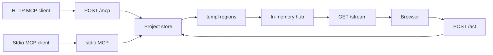

> **Superseded by [docs/final-requeriments.md](../final-requeriments.md).** Kept for history; do not build from this file.

# AgentCanvas Go Studio

Any coding agent that speaks MCP can drive this app. The server implements the public protocol only: no Claude, Cursor, or Codex headers, prompts, or config formats baked into the handlers. An agent that cannot see the browser must still be able to learn the tool list, read the project, change it, and read back what changed.

The product behavior stays in [docs/ui/requeriments.md](docs/ui/requeriments.md) (§1–§3, §5–§11, §14–§15). Two choices override that file’s delivery rules:

- Build the studio with Go, templ, and Datastar. Do not build the React `index.html`.
- A skill is a folder with `SKILL.md` and `skill.json`. The binary stores it and serves it over MCP. It does not register tools or run code.

Void from the UI spec: §4 (single `index.html`, `file://`, “do not add Go”), the React/Babel/Tailwind CDN block, and `localStorage` in §12. Persistence becomes a JSON file. One process owns one project, and every open browser sees it.

Replace the JetBrains stub in [main.go](main.go). [go.mod](go.mod) is only `module agentcanvas` and needs a Go version.

## Architecture

- `net/http` with Go 1.22+ method patterns. No chi.
- MCP: `github.com/modelcontextprotocol/go-sdk` v1.7.0. Streamable HTTP uses `Stateless: true` so each request stands alone and any client can connect without a sticky session. The SDK negotiates the protocol version; do not require a vendor build. Tool handlers close over the process store. MCP session state stays empty.
- UI: `github.com/a-h/templ` components. Live updates: `github.com/starfederation/datastar-go` (`NewSSE` + `PatchElements`). Page root uses `data-init="@get('/stream')"`. Requires Go 1.24+.
- Tailwind standalone CLI writes one CSS file that is embedded. Dynamic colors stay inline `style` attributes, matching the UI spec. Datastar script is pinned and embedded so the binary works offline.
- `air` reloads the dev process. `templ generate` runs before each build.

Bind `127.0.0.1` and start at port `47321`. If it is taken, try the next 20 ports, then exit `2`. Print the UI URL, the MCP URL, and a one-line note that any streamable-HTTP MCP client can use that URL. No auth in this version; loopback is the boundary. Allow CORS on `/mcp` only for loopback origins, so a browser-hosted agent on this machine can call it.

## Layout

- [cmd/agent-canvas/main.go](cmd/agent-canvas/main.go) — CLI entry
- `internal/cli` — `serve`, `serve --stdio`, `attach`, `skills list|install|remove`, `version`, `--help`
- `internal/server` — mux, port scan, `/healthz`, `/act`, `/stream`, `/`, `/guide`, `/mcp.json`
- `internal/hub` — subscriber channels; drop slow clients
- `internal/studio` — types from §6, `makeSeed()` from §7, pure reducer and invariants from §6.1, algorithms from §9
- `internal/skills` — validate and copy packages under `os.UserConfigDir()/agent-canvas/skills/<name>`
- `internal/mcp` — fixed tool wrappers, initialize instructions, `agentcanvas://guide`, HTTP and stdio transports over one store
- `ui/*.templ` — shell and the four editors
- `Makefile` — templ, tailwind, `build` for six targets (`CGO_ENABLED=0`: linux/darwin/windows, amd64 and arm64)

## One reducer for both doors

HTTP actions and MCP tools call the same `Reduce(project, ui, action)`. After each committed action the server re-renders four regions (`#topbar`, `#left`, `#canvas`, `#inspector`) and publishes those fragments. A reload or a new SSE connection renders from the store, not from leftover DOM.

Persist `agentcanvas.project.v1` and the durable UI subset to the user config dir, debounced 300ms, flushed on shutdown. Histories are memory-only, four stacks, 50 steps, coalesced gestures, as in §11.3.

Keyboard and pointer events use Datastar attributes (`data-on:keydown`, posts to `/act`). Draw pointer moves are coalesced to about 30 fps before a patch.

## Any agent can connect

One process owns the project. Both transports call that same store, so a browser and every agent stay on one canvas.

- `agent-canvas serve` exposes streamable HTTP at `/mcp`. Clients that already speak HTTP point at the printed URL. Nothing else is required: `initialize` and `tools/list` are the discovery mechanism.
- `agent-canvas serve --stdio` is the same process with MCP also on stdin/stdout, for clients that can only spawn a command.
- `agent-canvas attach` is a stdio proxy to an already running server. It does not open a second project. If nothing is listening, it exits with the command to start `serve`.

On startup the server also serves:

- `GET /guide` — markdown: what the studio is, the tool catalog, and “call `get_canvas` first.”
- `GET /mcp.json` — a generic `mcpServers` document whose URL is the port actually bound.
- MCP resource `agentcanvas://guide` with the same markdown.
- Initialize `instructions`: drive the studio only through these tools, call `get_canvas` before editing, read `skills_list` before inventing a workflow, and trust the tool result for what changed.

Tool descriptions name intent, inputs, and the invariant they can fail. Schemas are the contract. No tool mentions a specific agent product.

## MCP tools

Intent tools only. No `patch_html` and no `execute_js`.

- Read: `get_canvas`, `skills_list` (name, version, description, `SKILL.md` body)
- Navigate: `set_tab`, `set_breakpoint`, `set_selection`, `preview`
- History: `undo`, `redo`, `reset_project`
- Edit: `update_tokens`, `upsert_flow`, `delete_flow`, `upsert_node`, `delete_node`, `set_link_target`, `update_block`, `reorder_blocks`, `update_screen`, `update_hotspot`, `add_shape`, `update_shape`, `delete_shape`, `set_doc`, `add_pin`, `update_pin`, `delete_pin`
- Output: `export` returns the §11.4 / §11.5 file text
- Packages: `skills_install` and `skills_remove` copy or delete a validated folder. They do not add tools.

`get_canvas` is the screen substitute. It returns tab, breakpoint, selection, tokens, flows, nodes (ids, names, block or screen summaries), edges, doc headings, pins, contrast and tap-target failures, and installed skill names. An agent can design from that JSON without a screenshot.

Every mutation returns a short JSON result: `ok`, a one-line `summary`, the selection, the open issues, and the ids that changed. A refused action is an MCP tool error whose text says which invariant failed and what to call next. Handlers never return a bare “updated.”

`skill.json` is `{ "name", "version", "description" }` with a kebab-case name. Install is all-or-nothing. CLI and MCP use the same functions.

The chrome shows installed skill names. Installing a skill publishes a region patch. Skills do not change studio behavior. The tool list is fixed in the binary, so every agent sees the same capabilities after `tools/list`.

## Build order

Follow §13 milestones. Behavior and acceptance tests stay §14 and §15. After each milestone, click through that milestone in a browser before starting the next.

1. Toolchain, mux, health, port scan, empty templ page, SSE round-trip.
2. Seed project, reducer invariants, undo, disk persistence. Shell: tabs, tokens, export menu with reset.
3. Doc tab and DESIGN.md export.
4. Flow graph and storyboard for web and mobile.
5. Web editor, breakpoints, preview.
6. Mobile editor and play.
7. SVG draw.
8. Pins, contrast, tap-target checks.
9. Skills CLI plus the MCP catalog above. Prove it with two clients against the same process: the official SDK, and a raw streamable-HTTP `initialize` plus `tools/list` plus `get_canvas` with no vendor headers. A `--stdio` client must change the same project the browser is showing.
10. Six release binaries. Walk §15 and record pass/fail against §14.

Out of scope: NATS/Redis, bearer auth, git-URL skill installs, skill code execution, agent-specific plugins, and the React studio.
