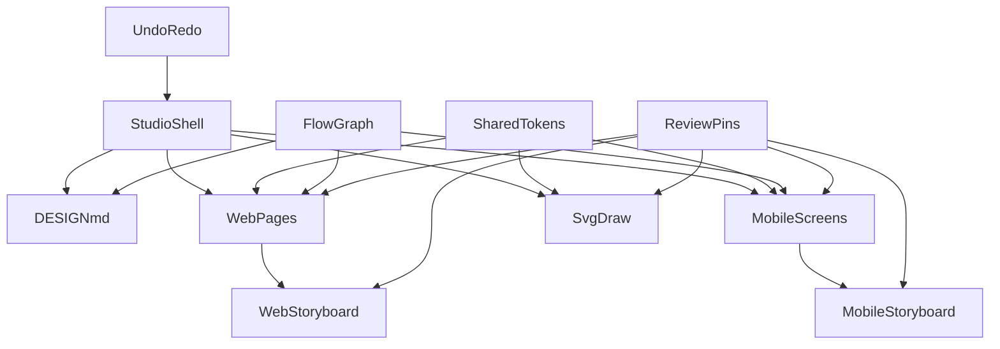

> **Superseded by [docs/final-requeriments.md](../final-requeriments.md).** Kept for history; do not build from this file.

# AgentCanvas — requirements and build spec

This document is the single source of truth for building AgentCanvas. It is written for coding agents. Every section is normative unless it is marked *Guidance*. When two sections seem to conflict, the more specific one wins (a table of values beats prose).

## 0. How to use this document

- **Read §1–§7 fully before writing code.** They define constraints, the data model, tokens, and the seed project. Everything else depends on them.
- **Build in the milestone order in §13.** Each milestone has a "done when" list. Do not start the next milestone until the current one is verified in a real browser.
- **Every numbered requirement in §3 has acceptance criteria in §14.** Treat §14 as the test plan. A requirement is not done until its criteria pass.
- **Do not add anything not listed in §16 (out of scope) or invent new libraries.** If something is ambiguous, pick the simplest behavior that satisfies §14 and leave a short `// SPEC:` comment at the decision point in the code.
- Terms in **bold** in §2 are used consistently throughout; use the same names for variables, components, and UI labels.

## 1. Job to be done

A designer uses one page to **create** and **improve** UI and UX: write intent, map connected flows, edit web pages and mobile screens, draw, preview as a user, mark issues, fix, repeat.

The product is a studio, not a mockup. Every visible control must work; nothing is decorative placeholder UI.

## 2. Glossary

| Term | Meaning |
|---|---|
| **Project** | The whole persisted state: tokens, flows, nodes, edges, draw shapes, doc markdown, pins. One per browser origin. |
| **Tab** | Top-level mode: `web`, `story`, `draw`, `doc`. |
| **Channel** | `web` or `mobile`. Flows, nodes, and edges belong to exactly one channel. |
| **Flow** | A named group of nodes with one start node. Example: "Marketing", "Onboarding". |
| **Node** | A **page** (web channel) or a **screen** (mobile channel). |
| **Edge** | A directed connection between two nodes in the same channel. May cross flows. |
| **Cross-flow edge** | An edge whose `fromId` and `toId` live in different flows. Always rendered in the accent color. |
| **Block** | A section inside a web page (Nav, Hero, Features, Quote, CTA band, Footer). |
| **Child** | A nested, individually selectable item inside a block (a nav link, a feature card, a footer link). |
| **Archetype** | The template a mobile screen is built from (Title, Photo, Quote, CTA, Split). |
| **Hotspot** | A tappable rectangle on a mobile screen that targets a node. |
| **Page view** | Editing surface for one node. |
| **Storyboard view** | Map of all flows in the current channel with their edges. |
| **Preview** (web) / **Play** (mobile) | Chrome-less walkthrough that follows edges. |
| **Pin** | A numbered review annotation (Issue, Suggestion, Question). |
| **Tokens** | Shared named values for color, type, and space. |
| **Inspector** | Right panel. Tabs: Content, Design, Review. Shows edge properties when an edge is selected. |
| **Outline** | Left panel tree: flows → nodes → blocks → children. |
| **Palette** | Left panel insert list (blocks, archetypes, draw tools). |
| **Specs overlay** | Red-line style labels showing px sizes on the selected object. |

## 3. Requirements checklist

Everything below is in scope. The implementation must cover each item. Acceptance criteria for each number are in §14.

### 3.1 Create three things (plus Doc)

1. **Design a web page** — multi-page web UI builder with real visual editing.
2. **Design a mobile story-flow app** — phone-frame screens in named flows.
3. **Design an SVG diagram / draw** — freehand + shapes on a native SVG canvas.
4. **DESIGN.md space** — first-class Doc tab to write and export `DESIGN.md`.

### 3.2 Storyboards that connect different flows (web and mobile)

5. Web and mobile each have **named flows** (not one linear strip).
6. **Page view** edits one page/screen; **Storyboard view** shows all flows as connected thumbnails.
7. Designer can **connect different flows** (cross-flow edges, e.g. Onboarding last screen → Home, Shop → Cart).
8. One node may have **several outbound edges** (branches: CTA, Skip, Error, Back).
9. Preview/Play **follows edges**, not array order, including jumps into another flow.
10. Create, rename, and delete flows, pages, and screens from Outline.

### 3.3 Improve UI and UX (designer loop)

11. **Shared tokens** — colors `paper, ink, muted, accent, wash, line`; type `xs sm md lg xl display`; space `0 4 8 16 24 32 48 64`.
12. **Craft inspector** — type role, weight, alignment, padding/gap from the space scale, fill/ink from tokens (not only copy + hex).
13. **Undo / redo** — per-document history (50 steps), `Cmd/Ctrl+Z` and `Cmd/Ctrl+Shift+Z`.
14. **Preview / Play** — hide studio chrome; `Esc` exits. Web: current page at current breakpoint, in-page links navigate via edges. Mobile: start at flow `startId`, taps follow edges.
15. **Breakpoints (web)** — Desktop 1280, Tablet 768, Phone 390. Nav collapses, feature grid 3→2→1, type steps down.
16. **Outline** — flows → pages/screens → blocks → nested children. Click to select what the canvas would miss.
17. **Nested select** — e.g. one feature card or one nav link, not only the whole block.
18. **Specs overlay** — selected object shows type size and padding in px.
19. **12-column overlay** on the web page frame (toggle).
20. **8px snap** in draw (hold Alt to disable).
21. **Contrast check** — flag fill vs ink below AA for body text.
22. **Tap-target check** — flag mobile CTAs and hotspots under 44px.
23. **Keyboard** — `Esc` deselect/exit preview, `Delete`/`Backspace` remove, `Cmd/Ctrl+D` duplicate, `Cmd/Ctrl+Z` undo, `Cmd/Ctrl+Shift+Z` redo, `Space` (held) pan in draw.

### 3.4 Annotations

24. Figma-style **numbered pins** on web pages, mobile screens, storyboard nodes, and the SVG canvas.
25. Pin kinds: **Issue | Suggestion | Question**.
26. Annotate mode: click to place, type note, Enter to save; drag to move; Resolve / Delete.
27. Notes list with filters (kind, Open/Resolved) and jump-to-pin.
28. **Show pins** can stay on while designing. Top bar **open-issue count**.
29. Pins persist with the project. They are **not** included in HTML/SVG exports; they **are** listed in the DESIGN.md appendix.

### 3.5 Starter project (never empty)

30. Seed slightly **flawed** UI so there is something to improve (tight type, one low-contrast CTA, one too-small mobile CTA).
31. Two **web** flows already connected: Marketing (Home → Shop) **cross** into Checkout (Cart → Confirm), plus two Issue pins.
32. Two **mobile** flows already connected: Onboarding (3 screens, last CTA **cross** to Home) plus Account.
33. DESIGN.md seeded with Intent, Users, Principles, Decisions for that starter product.

## 4. Hard constraints

### 4.1 Files

- Exactly one deliverable: `index.html` at the repo root. Opening it with `file://` in Chrome, Safari, or Firefox must work. No dev server required.
- No npm, no bundler, no `package.json`, no extra `.css` or `.js` files.
- Leave `main.go` and `go.mod` untouched. Do not add Go code.
- Do not modify this document as part of implementation. Record deviations in the final report instead.

### 4.2 Allowed external resources (exact)

Load these and nothing else:

```html
<script src="https://unpkg.com/react@18.3.1/umd/react.development.js" crossorigin></script>
<script src="https://unpkg.com/react-dom@18.3.1/umd/react-dom.development.js" crossorigin></script>
<script src="https://unpkg.com/@babel/standalone@7.24.7/babel.min.js"></script>
<script src="https://cdn.tailwindcss.com"></script>
<link href="https://fonts.googleapis.com/css2?family=Inter:wght@400;500;600&family=Fraunces:opsz,wght@9..144,400;9..144,500;9..144,600&display=swap" rel="stylesheet">
```

- Application code lives in one `<script type="text/babel" data-presets="react">` block.
- Tailwind config is an inline `<script>tailwind.config = {...}</script>` placed **after** the Tailwind CDN script and **before** the Babel script. Extend `fontFamily.ui` = Inter, `fontFamily.serif` = Fraunces, and the six token colors as static Tailwind colors (`paper`, `ink`, `muted`, `accent`, `wash`, `line`) for **chrome only**.
- **No canvas libraries** (no Konva, Fabric, Rough, D3). Draw is native SVG. Markdown rendering is an in-file function.
- **Dynamic colors use inline `style={{}}`**, never dynamic Tailwind class names (the CDN runtime cannot see them). Static chrome classes are fine.

### 4.3 Runtime

- React 18 with hooks only. No class components, no external state library.
- Must run without console errors or React warnings in Chrome stable.
- Must restore the full project from `localStorage` on reload (§12).
- Must stay responsive with the seed project: no interaction may take longer than 100 ms on a 2020 laptop. Avoid re-rendering the whole canvas on each keystroke (memoize block components; keep history snapshots shallow where possible).

## 5. Tokens and scales

Tokens are project data (editable, undoable, persisted). The defaults below are the seed values.

### 5.1 Colors (`tokens.colors`)

| key | default | role |
|---|---|---|
| `paper` | `#F4EFE6` | default page/screen background |
| `ink` | `#1C1B19` | default text |
| `muted` | `#6B665C` | secondary text |
| `accent` | `#D8432A` | vermillion: CTAs, selection, pins, cross-flow edges |
| `wash` | `#E9E2D4` | alternate section background |
| `line` | `#CFC6B5` | borders, dividers |

Any block/screen field typed `ColorKey` holds one of these six keys, never a hex. Resolve with `tokens.colors[key]` at render time. The Design inspector offers a color input per token so the designer edits the hex once and everything updates.

### 5.2 Type (`tokens.type`)

| key | size px | line-height px | default weight | family |
|---|---|---|---|---|
| `xs` | 12 | 16 | 400 | serif |
| `sm` | 14 | 20 | 400 | serif |
| `md` | 17 | 26 | 400 | serif |
| `lg` | 22 | 30 | 500 | serif |
| `xl` | 32 | 38 | 500 | serif |
| `display` | 52 | 56 | 600 | serif |

- Order for stepping: `xs < sm < md < lg < xl < display`. `stepDown(role, n)` moves `n` steps toward `xs` and clamps.
- Allowed weights: `400 | 500 | 600`.
- Designed content uses the serif family. Studio chrome uses the `ui` family. Never mix.

### 5.3 Space (`tokens.space`)

`[0, 4, 8, 16, 24, 32, 48, 64]` in px. Fields typed `SpaceIdx` hold an **index** 0–7, not a px value. The inspector shows a segmented control labeled with the px values.

### 5.4 Breakpoints (constant, not editable)

| name | frame width px | columns in Features | nav | type step-down |
|---|---|---|---|---|
| `desktop` | 1280 | 3 | inline links | 0 |
| `tablet` | 768 | 2 | inline links | 1 for `display` and `xl` only |
| `phone` | 390 | 1 | collapsed to a "Menu" toggle | 1 for all roles ≥ `lg`; also padding index −1 (min index 3 = 16px) |

### 5.5 Chrome palette (constant)

Studio UI uses charcoal tools on warm paper: toolbars `#232220` with `#F4EFE6` text, panels `#FBF8F2`, hairlines `#DDD5C4`, selection and focus rings `#D8432A`. Pins and cross-flow edges always use `#D8432A` regardless of the project's `accent` token.

## 6. Data model

Types are written in TypeScript syntax for precision; the implementation is plain JS. All ids are strings from `uid()` (8 chars, base36). Seed data uses readable ids (`pg_home`) so tests can reference them.

```ts
type Channel = 'web' | 'mobile';
type Tab = 'web' | 'story' | 'draw' | 'doc';
type ColorKey = 'paper' | 'ink' | 'muted' | 'accent' | 'wash' | 'line';
type TypeKey = 'xs' | 'sm' | 'md' | 'lg' | 'xl' | 'display';
type SpaceIdx = 0 | 1 | 2 | 3 | 4 | 5 | 6 | 7;
type Weight = 400 | 500 | 600;
type Align = 'left' | 'center';

interface Project {
  version: 1;
  tokens: {
    colors: Record<ColorKey, string>;          // hex
    type: Record<TypeKey, { size: number; lh: number; weight: Weight }>;
    space: number[];                           // fixed length 8
  };
  flows: Flow[];
  nodes: Node[];
  edges: Edge[];
  draw: { shapes: Shape[]; view: { x: number; y: number; zoom: number } };
  doc: { markdown: string };
  pins: Pin[];
  pinCounter: number;                          // last issued pin number
}

interface Flow { id: string; name: string; channel: Channel; startId: string | null }

type Node = WebPage | MobileScreen;

interface WebPage {
  kind: 'page'; id: string; flowId: string; name: string;
  blocks: Block[];
}

interface MobileScreen {
  kind: 'screen'; id: string; flowId: string; name: string;
  archetype: 'title' | 'photo' | 'quote' | 'cta' | 'split';
  layout: 'center' | 'bottom' | 'split';
  fill: ColorKey; ink: ColorKey;
  title: string; body: string;
  typeRole: TypeKey; weight: Weight; align: Align; pad: SpaceIdx; gap: SpaceIdx;
  cta: { label: string; toId: string | null; size: 'sm' | 'md' | 'lg'; fill: ColorKey; ink: ColorKey } | null;
  hotspots: Hotspot[];
}

interface Hotspot { id: string; label: string; x: number; y: number; w: number; h: number; toId: string | null }
// x,y,w,h in screen px (0..390 × 0..844)

interface Edge {
  id: string; fromId: string; toId: string;
  label: string;
  kind: 'primary' | 'alt' | 'back' | 'cross';
}

interface BlockBase {
  id: string; type: Block['type'];
  fill: ColorKey; ink: ColorKey;
  pad: SpaceIdx; gap: SpaceIdx;
  typeRole: TypeKey; weight: Weight; align: Align;
}
interface Link { id: string; label: string; toId: string | null }
interface NavBlock      extends BlockBase { type: 'nav';      brand: string; links: Link[] }
interface HeroBlock     extends BlockBase { type: 'hero';     eyebrow: string; headline: string; body: string; bodyRole: TypeKey; cta: Link; secondary: Link | null }
interface FeaturesBlock extends BlockBase { type: 'features'; heading: string; items: { id: string; title: string; body: string }[] }
interface QuoteBlock    extends BlockBase { type: 'quote';    text: string; cite: string }
interface CtaBlock      extends BlockBase { type: 'cta';      headline: string; body: string; button: Link; buttonFill: ColorKey; buttonInk: ColorKey }
interface FooterBlock   extends BlockBase { type: 'footer';   brand: string; note: string; links: Link[] }
type Block = NavBlock | HeroBlock | FeaturesBlock | QuoteBlock | CtaBlock | FooterBlock;

type Shape =
  | { id: string; type: 'rect';    x: number; y: number; w: number; h: number; stroke: ColorKey; fill: ColorKey | 'none'; sw: number }
  | { id: string; type: 'ellipse'; x: number; y: number; w: number; h: number; stroke: ColorKey; fill: ColorKey | 'none'; sw: number }
  | { id: string; type: 'line';    x1: number; y1: number; x2: number; y2: number; stroke: ColorKey; sw: number }
  | { id: string; type: 'arrow';   x1: number; y1: number; x2: number; y2: number; stroke: ColorKey; sw: number }
  | { id: string; type: 'text';    x: number; y: number; text: string; role: TypeKey; ink: ColorKey }
  | { id: string; type: 'pen';     points: [number, number][]; stroke: ColorKey; sw: number };

interface Pin {
  id: string; n: number;
  kind: 'issue' | 'suggestion' | 'question';
  body: string; resolved: boolean;
  target:
    | { type: 'node';  nodeId: string; blockId?: string }   // page or screen in Page view (fractions of node frame)
    | { type: 'board'; nodeId: string }                     // storyboard thumbnail (fractions of thumbnail)
    | { type: 'draw' };                                     // SVG world coordinates
  x: number; y: number;   // fractions 0..1 for node/board, world px for draw
  createdAt: number;
}
```

### 6.1 Invariants (enforce in reducers)

- `edge.fromId` and `edge.toId` reference nodes of the same channel. `fromId !== toId`. A link whose `toId` is its own node (e.g. the "Shop" nav link on the Shop page) is allowed and does nothing; it produces **no** edge.
- `edge.kind` is `'cross'` **iff** the two nodes are in different flows. Recompute kind on every edge create/retarget; the designer may change kind only among `primary | alt | back` when same-flow, and the UI shows `cross` read-only otherwise.
- At most one edge per `(fromId, toId, label)` triple. Different labels between the same two nodes are allowed (branches).
- Every `Link.toId`, `cta.toId`, `hotspot.toId` that is non-null **must** have a matching edge `{fromId: ownerNodeId, toId, label: link.label}`. Setting a link target creates/updates that edge; clearing it deletes the edge. Deleting an edge in the storyboard clears the matching `toId` on the owning link if one exists.
- Deleting a node deletes its edges (both directions), its pins (`node` and `board` targets), and clears any `toId` pointing to it. If it was the flow's `startId`, set `startId` to the first remaining node in that flow or `null`.
- Deleting a flow deletes its nodes (cascade above). A channel must keep at least one flow; disable delete on the last flow.
- `flow.startId` must belong to that flow.
- `pinCounter` only increases. Deleted numbers are never reused.
- `tokens.space` is always the 8-entry scale; it is displayed but not editable (the designer picks indices).

### 6.2 UI state (not persisted in the project, not undoable)

```ts
interface UiState {
  tab: Tab;
  view: { web: 'page' | 'board'; story: 'page' | 'board' };
  breakpoint: 'desktop' | 'tablet' | 'phone';
  currentNodeId: { web: string | null; mobile: string | null };
  selection: Selection;
  preview: boolean;
  annotate: boolean;
  showPins: boolean;
  showGrid: boolean;       // 12-column overlay
  showSpecs: boolean;
  drawTool: 'select' | 'pan' | 'rect' | 'ellipse' | 'line' | 'arrow' | 'text' | 'pen';
  inspectorTab: 'content' | 'design' | 'review';
  reviewFilter: { kind: 'all' | Pin['kind']; status: 'open' | 'resolved' | 'all' };
}
type Selection =
  | null
  | { kind: 'node';  nodeId: string }
  | { kind: 'block'; nodeId: string; blockId: string; childId?: string }
  | { kind: 'hotspot'; nodeId: string; hotspotId: string }
  | { kind: 'edge';  edgeId: string }
  | { kind: 'shape'; shapeId: string }
  | { kind: 'pin';   pinId: string };
```

`tab`, `view`, `breakpoint`, `currentNodeId`, `showPins`, `showGrid`, `showSpecs` are persisted separately under `agentcanvas.ui.v1` so a reload lands where the designer left off. Everything else resets.

## 7. Seed project (exact content)

The product being designed is **Hearth**, a small handmade-ceramics studio shop. Every id below is stable and used by §14.

### 7.1 Web flows

| flow id | name | startId |
|---|---|---|
| `fl_marketing` | Marketing | `pg_home` |
| `fl_checkout` | Checkout | `pg_cart` |

**`pg_home` — Home** (Marketing). Blocks in order:

1. `bk_home_nav` nav: brand "Hearth"; links `[ln_home_shop "Shop" → pg_shop, ln_home_story "Our story" → null, ln_home_cart "Cart" → pg_cart]`; fill `paper`, ink `ink`, pad 3, gap 4, typeRole `sm`.
2. `bk_home_hero` hero: eyebrow "Studio shop"; headline "Everyday ceramics, fired slowly."; body "Small batches thrown in a converted barn. Each piece carries the mark of the hand that made it."; cta `ln_home_cta "Browse the collection" → pg_shop`; secondary `ln_home_sec "Read our story" → null`; align `left`; fill `paper`, ink `ink`; typeRole `display`; **flaw:** `bodyRole: 'xs'`, `pad: 2`, `gap: 1` (tight type and spacing).
3. `bk_home_features` features: heading "Why Hearth"; items `[ft_1 "Stoneware that lasts" …, ft_2 "Glazes mixed in-house" …, ft_3 "Shipped with care" …]` (one-sentence bodies); fill `wash`, ink `ink`, pad 5, gap 4, typeRole `lg`.
4. `bk_home_quote` quote: text "The mug I reach for every morning."; cite "Ana, Lisbon"; fill `paper`, ink `muted`, pad 5, typeRole `xl`, align `center`.
5. `bk_home_footer` footer: brand "Hearth"; note "© Hearth Studio"; links `[ln_hf_story "Our story" → null, ln_hf_contact "Contact" → null]`; fill `ink`, ink `paper`, pad 4, gap 3, typeRole `sm`. Footer links never target pages in the seed, so footers add no edges.

**`pg_shop` — Shop** (Marketing). Blocks:

1. `bk_shop_nav` nav: same as home nav (fresh ids `ln_shop_*`, "Shop" → `pg_shop` (self, no edge), "Our story" → null, "Cart" → `pg_cart`).
2. `bk_shop_hero` hero: eyebrow "Collection"; headline "Mugs, bowls, and a few surprises."; body "Twelve pieces this season."; cta `ln_shop_cta "Add the Dawn mug" → pg_cart`; secondary null; typeRole `xl`; bodyRole `md`; pad 5; gap 3.
3. `bk_shop_features` features: heading "This season"; 3 items (Dawn mug, Ember bowl, Ash plate); fill `paper`; pad 5; gap 4; typeRole `lg`.
4. `bk_shop_cta` cta band: headline "Ready when you are."; body "Free shipping over €60."; button `ln_shop_band "Add to cart" → pg_cart`; fill `wash`, ink `ink`; **flaw:** `buttonFill: 'wash'`, `buttonInk: 'muted'` (fails AA); pad 5; typeRole `lg`.
5. `bk_shop_footer` footer: as home footer.

**`pg_cart` — Cart** (Checkout). Blocks: nav (`ln_cart_*`: "Shop" → `pg_shop`, "Our story" → null, "Cart" → `pg_cart` (self, no edge)), hero (headline "Your cart"; body "1 item · Dawn mug · €28"; cta `ln_cart_pay "Pay €28" → pg_confirm`; secondary `ln_cart_back "Keep shopping" → pg_shop`; typeRole `xl`; bodyRole `md`), footer.

**`pg_confirm` — Confirm** (Checkout). Blocks: nav (`ln_conf_*`: "Shop" → `pg_shop`, "Our story" → null, "Cart" → `pg_cart`), hero (eyebrow "Order 1042"; headline "Thank you."; body "We'll email you when it ships."; cta `ln_conf_home "Back to Hearth" → pg_home`; typeRole `display`; bodyRole `md`), footer.

**Web edges** (derived from the links above; the seed contains exactly these twelve, one per non-null, non-self link):

| id | from | to | label | kind | source |
|---|---|---|---|---|---|
| `ed_w1` | pg_home | pg_shop | Shop | primary | nav link |
| `ed_w2` | pg_home | pg_shop | Browse the collection | primary | hero CTA |
| `ed_w3` | pg_home | pg_cart | Cart | cross | nav link |
| `ed_w4` | pg_shop | pg_cart | Cart | cross | nav link |
| `ed_w5` | pg_shop | pg_cart | Add the Dawn mug | cross | hero CTA |
| `ed_w6` | pg_shop | pg_cart | Add to cart | cross | CTA band |
| `ed_w7` | pg_cart | pg_shop | Shop | cross | nav link |
| `ed_w8` | pg_cart | pg_confirm | Pay €28 | primary | hero CTA |
| `ed_w9` | pg_cart | pg_shop | Keep shopping | cross | hero secondary |
| `ed_w10` | pg_confirm | pg_shop | Shop | cross | nav link |
| `ed_w11` | pg_confirm | pg_cart | Cart | cross | nav link |
| `ed_w12` | pg_confirm | pg_home | Back to Hearth | cross | hero CTA |

Edges that share the same `(from, to)` pair (for example `ed_w1`/`ed_w2`) are drawn as separate curves with offset labels (§8.2). The storyboard must never draw two curves for one edge.

### 7.2 Mobile flows

| flow id | name | startId |
|---|---|---|
| `fl_onboarding` | Onboarding | `sc_welcome` |
| `fl_account` | Account | `sc_home` |

| id | flow | name | archetype | layout | fill/ink | typeRole | cta | hotspots |
|---|---|---|---|---|---|---|---|---|
| `sc_welcome` | Onboarding | Welcome | title | center | paper/ink | display | "Get started" → `sc_craft`, size md, accent/paper | `hs_skip` "Skip" (x 300 y 60 w 70 h 44) → `sc_home` |
| `sc_craft` | Onboarding | Pick your craft | split | split | wash/ink | xl | "Next" → `sc_notify`, size md | none |
| `sc_notify` | Onboarding | Notifications | cta | bottom | paper/ink | xl | "Allow and finish" → `sc_home`, size md | `hs_later` "Not now" (x 95 y 760 w 200 h 44) → `sc_home` |
| `sc_home` | Account | Home | photo | bottom | ink/paper | xl | "Shop the season" → null, size md | `hs_avatar` "Profile" (x 326 y 56 w 44 h 44) → `sc_profile` |
| `sc_profile` | Account | Profile | title | center | paper/ink | lg | **flaw:** "Sign out" → `sc_home`, `size: 'sm'` (36 px, fails tap check) | `hs_back` "Back" (x 16 y 56 w 44 h 44) → `sc_home` |

**Mobile edges:**

| id | from | to | label | kind |
|---|---|---|---|---|
| `ed_m1` | sc_welcome | sc_craft | Get started | primary |
| `ed_m2` | sc_welcome | sc_home | Skip | cross |
| `ed_m3` | sc_craft | sc_notify | Next | primary |
| `ed_m4` | sc_notify | sc_home | Allow and finish | cross |
| `ed_m5` | sc_notify | sc_home | Not now | cross |
| `ed_m6` | sc_home | sc_profile | Profile | primary |
| `ed_m7` | sc_profile | sc_home | Sign out | back |
| `ed_m8` | sc_profile | sc_home | Back | back |

### 7.3 Draw seed

A small motif, not a copy of the flow graph: one rect (120,120,220,140, stroke `ink`, fill `wash`), one ellipse (420,140,120,100, stroke `accent`, fill `none`), one arrow from (340,190) to (420,190) stroke `ink`, one text at (120,90) "Hearth — kiln map" role `lg`, one pen stroke of ~12 points forming a loose loop. `view = {x: 0, y: 0, zoom: 1}`.

### 7.4 Seed pins

| n | kind | target | x,y | body |
|---|---|---|---|---|
| 1 | issue | node `pg_home`, block `bk_home_hero` | 0.55, 0.62 | Body copy is set in `xs` with 8px padding. Reads cramped next to the display headline. |
| 2 | issue | node `pg_shop`, block `bk_shop_cta` | 0.5, 0.7 | "Add to cart" button is muted-on-wash. Fails AA. |

`pinCounter = 2`.

### 7.5 Seed DESIGN.md

```md
# Hearth — DESIGN.md

## Intent
Hearth sells small-batch ceramics directly from the studio. The site and app should feel like the studio: unhurried, warm, exact. One clear path to buy; no dark patterns.

## Users
- **Returning buyers** who know the glaze they want and need to reorder in under a minute.
- **Gift shoppers** who need confidence (photos, size, shipping date) before paying.
- **The studio** (two people) who update stock from a phone between firings.

## Principles
1. **Paper first.** Warm paper background, charcoal ink, one vermillion accent. Color is for action, not decoration.
2. **Serif for the product, grotesque for the tools.** Content should read like a printed catalogue.
3. **One accent per screen.** If two things are vermillion, one of them is wrong.
4. **Thumbs before cursors.** Every mobile target is at least 44px.
5. **Say less.** Headlines under eight words; bodies under thirty.

## Decisions
- Checkout is its own flow so Marketing can change without touching payment.
- Onboarding ends by jumping into Account › Home; there is no separate "done" screen.
- Shop and Cart share the nav so the cart is always one tap away.
- Features grid collapses 3 → 2 → 1 rather than scrolling horizontally.
```

## 8. Product shape and behavior

### 8.1 Layout and chrome



Fixed grid, full viewport, no page scroll (panels scroll internally):

```
┌──────────────────────────────────────────────────────────────────────┐
│ TopBar 48px: [Web|Story|Draw|Doc]  · context controls ·  ⟲ ⟳  Export│
├──────────┬───────────────────────────────────────────┬───────────────┤
│ Left     │ Canvas (scrolls, warm paper backdrop)     │ Inspector     │
│ 260px    │                                           │ 300px         │
│ Palette  │                                           │ Content /     │
│ ──────   │                                           │ Design /      │
│ Outline  │                                           │ Review        │
└──────────┴───────────────────────────────────────────┴───────────────┘
```

**TopBar context controls by tab**

| tab | controls |
|---|---|
| web | `Page \| Storyboard` toggle · breakpoint segmented `1280 / 768 / 390` · `Grid` toggle · `Specs` toggle · `Preview` · `Annotate` · `Show pins` · open-issue badge |
| story | `Page \| Storyboard` toggle · `Specs` toggle · `Play` · `Annotate` · `Show pins` · open-issue badge |
| draw | tool buttons `Select Pan Rect Ellipse Line Arrow Text Pen` · zoom `− 100% +` · `Annotate` · `Show pins` · open-issue badge |
| doc | word count · `Export DESIGN.md` · open-issue badge |

Undo/redo buttons and the Export menu are always present. Buttons show a tooltip with the shortcut.

**Open-issue badge**: count of pins where `kind === 'issue' && !resolved` across the whole project. Clicking it opens the Review tab of the inspector filtered to Issues/Open.

**Visual direction (Guidance):** print-atelier. Charcoal tools, warm paper canvas, vermillion only for selection, pins, cross-flow edges, and primary actions. Compact grotesque for tool UI (13px Inter), serif for designed content. No gradients, no purple, no glassmorphism, no rounded-everything (4px radius on controls, 0 on canvases).

### 8.2 Flow graph and Storyboard view

**Left panel in web/story tabs**

- Palette (top, collapsible): web shows the six block types; story shows the five archetypes. Click inserts after the selected block (web) or appends a new screen to the current flow (story).
- Outline (bottom, fills the rest): tree `Flow ▸ Node ▸ Block ▸ Child`. Each flow row has `+ page/screen`, `rename` (double-click), `delete` (hover ×). Each node row has `set as start` (hover ★), `rename`, `delete`. Clicking any row selects it and scrolls the canvas to it. The current node is highlighted; the start node shows a filled ★.
- `+ Flow` button at the top of the outline creates `{ name: 'Untitled flow', channel, startId: null }` and one empty node inside it, and enters rename mode.

**Storyboard view** (`view[tab] === 'board'`)

- Auto layout, deterministic, no manual node positions: one **lane per flow**, stacked vertically in `flows` order. Lane header shows name, node count, and a ★ marker next to the start thumbnail.
- Within a lane, nodes are ordered by BFS from `startId` following edges with `kind !== 'back'`; unreached nodes follow in `nodes` order. Thumbnails are laid left to right.
- Thumbnail sizes: web `220×140` (page rendered at 1280 and scaled via CSS `transform: scale()`); mobile `110×220`. Horizontal gap 64 px, lane gap 56 px, lane left padding 32 px.
- Each thumbnail has an **output port** (circle, right-middle) and an **input port** (left-middle). Drag from an output port to any thumbnail in the same channel (any lane) to create an edge. On drop, show an inline label input prefilled `"Link"`; Enter commits, Esc cancels. Kind is auto-set (`cross` if lanes differ, else `primary`).
- Edges are SVG cubic Béziers from output port to input port, drawn in a single overlay `<svg>` above the thumbnails. Style: `primary` solid 1.5px ink; `alt` dashed `6 4`; `back` dotted `2 4` drawn below the lane (curve bows downward); `cross` solid 2px `#D8432A`. Arrowhead at the target. Label in a small pill at the curve midpoint; when several edges share the same from/to pair, offset each by 14 px vertically so labels do not overlap.
- Click an edge (hit test within 6 px of the curve, or click the label) to select it. Inspector shows **Edge** panel: label text, kind radio (disabled with explanation when cross), from/to names, `Delete edge`.
- Click a thumbnail to select the node; double-click opens it in Page view. `Delete` on a selected node in storyboard deletes it (with confirm if it has blocks/pins).
- Storyboard supports pins (target `board`), `Annotate`, and `Show pins`.

### 8.3 Web page designer

**Canvas**: a frame of the current breakpoint width, centered, with a drop shadow, on the paper backdrop. The page scrolls inside the canvas area. Width changes animate 150 ms.

**Blocks render rules**

| block | structure | breakpoint behavior |
|---|---|---|
| nav | brand left (typeRole, weight 600), links right in a row | `phone`: links hidden behind a "Menu" button; clicking toggles a stacked list below the bar (also works in Preview) |
| hero | eyebrow (`sm`, muted, uppercase tracking), headline (`typeRole`), body (`bodyRole`), CTA button (accent fill / paper ink), secondary as text link; max width 720 px when `align: left`, centered column when `center` | type step-down per §5.4; `phone` also reduces `pad` by one index (min 3) |
| features | heading (`typeRole`), grid of cards, each with title (`md`, weight 600) and body (`sm`) | 3 / 2 / 1 columns |
| quote | large quoted text (`typeRole`), cite (`sm`, muted) | type step-down |
| cta | headline, body, one button (`buttonFill`/`buttonInk`) | type step-down |
| footer | brand, links row, note (`xs`, muted) | `phone`: links stack vertically |

- Every block is a padded `<section>` with `background: colors[fill]`, `color: colors[ink]`, `padding: space[pad]px (horizontal: max(space[pad], 24px))`, and vertical rhythm `gap: space[gap]px`.
- Buttons: height 44 px, padding `0 20px`, radius 4, `sm` weight 600.
- Any element with a `toId` shows a pointer cursor and a tiny ↗ badge on hover in edit mode; in Preview it navigates.

**Selection**

- Click a block → select block (vermillion 2 px outline, label chip with the block type top-left).
- Click a child (nav link, feature card, footer link) → select child (dashed vermillion outline on the child, solid on the parent). Click again on the same child toggles back to the block.
- Outline mirrors selection both ways.
- Drag the block's label chip to reorder blocks (vertical only; a 2 px vermillion insertion line shows the drop position). Reorder is one history step.
- Inspector header actions on a selected block: `Duplicate` (inserts a deep copy with new ids directly after), `Delete`, `↑ ↓` move.

**Inspector › Content** (per block): text inputs for every string field; for lists (`links`, `items`) a row per child with text, a **Target** dropdown (grouped by flow: "Marketing › Home", "Checkout › Cart", plus "No link"), `+ add`, and `×`. CTA buttons also show the Target dropdown. Changing a Target writes the edge per §6.1.

**Inspector › Design** (per block or child): segmented `typeRole`, segmented `weight`, segmented `align`, `pad` and `gap` from the space scale, `fill` and `ink` as token swatches (six swatches each, current one ringed), plus `buttonFill/buttonInk` on cta. Below: **Contrast** readout for the block's body text (`fill` vs `ink`, or `buttonFill` vs `buttonInk`) with the ratio to one decimal and a pass/fail chip (§9.2). Bottom of the panel: **Project tokens** section with six color inputs and the type table (size/line-height numeric inputs) — editing here is global.

**Specs overlay** (`showSpecs`): on the selected block or child, draw measurement labels: font size/line-height of the main text element (`17/26`), padding on top and left (`24`), gap between children (`16`). Labels are 10 px Inter in vermillion with hairline guides. Works at every breakpoint and reflects stepped-down values, not the token value.

**12-column overlay** (`showGrid`): 12 translucent vermillion columns over the page frame; gutter 24 px, side margin 24 px at `desktop`, 16 px at `tablet` and `phone`. Non-interactive (`pointer-events: none`).

### 8.4 Mobile story designer

**Canvas**: a phone bezel `390×844` content area, 24 px dark bezel, 40 px radius, centered. Inside: status bar (time "9:41", signal/battery glyphs drawn with CSS), **story progress bars** at the top (one segment per screen in the current flow in BFS order, current one filled), screen content, home indicator.

**Filmstrip** below the phone: thumbnails (`60×130`) of the **current flow only**, in BFS order, with a `+` tile at the end that adds a screen. Click selects; drag reorders *node order* only (does not change edges).

**Archetypes** (initial field values when inserted; the designer can change any field afterwards):

| archetype | layout | what renders |
|---|---|---|
| title | center | title (`typeRole`), body (`md`), CTA at bottom |
| photo | bottom | full-bleed "photo" (diagonal hatch pattern in `wash`/`line`, no image uploads), gradient scrim, title+body+CTA in bottom third |
| quote | center | large quote (`typeRole`), cite as body (`sm`, muted), CTA optional |
| cta | bottom | title + body top-aligned, CTA pinned to bottom with safe-area padding |
| split | split | top half `wash` panel with title, bottom half `fill` with body + CTA |

- CTA button height: `sm` 36, `md` 44, `lg` 52. Width `390 − 2×space[pad]`.
- Hotspots render as dashed vermillion rectangles with a label chip in edit mode and are invisible (but tappable) in Play. Create with `+ Hotspot` in Content; drag to move; drag the bottom-right handle to resize; numeric x/y/w/h fields in the inspector.
- **Inspector › Content**: name, title, body, CTA label + Target + size, hotspots list (label, Target, x/y/w/h). **Inspector › Design**: archetype, layout, typeRole, weight, align, pad, gap, fill/ink, CTA fill/ink, Contrast readout, **Tap targets** readout listing every CTA/hotspot with its px height and a pass/fail chip (§9.4).

### 8.5 SVG draw

- A single `<svg>` filling the canvas area; world transform `translate(view.x, view.y) scale(view.zoom)`. Background: paper with a faint 8 px dot grid (drawn with a `<pattern>`) that scales with zoom.
- Tools: `Select` (click/drag select, move, resize), `Pan` (drag), `Rect`, `Ellipse`, `Line`, `Arrow`, `Text` (click places, inline `<foreignObject>` input until Enter/blur), `Pen` (freehand polyline, points sampled every ≥2 px of movement, simplified by dropping points closer than 1.5 px).
- Holding `Space` temporarily switches to Pan. Wheel zooms around the cursor between `0.25` and `4`; `Cmd/Ctrl+0` resets. `+`/`−` buttons step zoom by 1.25×.
- **Snap**: while creating, moving, or resizing, snap x/y to the 8 px grid unless `Alt` is held. Pen never snaps.
- Selection handles: 8 handles on rect/ellipse (resize), 2 endpoint handles on line/arrow, bounding box only on text and pen (move). `Delete` removes. `Cmd/Ctrl+D` duplicates with a +16/+16 offset.
- Inspector › Design for a shape: stroke token, fill token or none, stroke width `1 | 1.5 | 2 | 3`, text role for text shapes.
- Arrowheads use a `<marker>` whose color follows the shape's stroke token (one marker per token key).
- **Not** a storyboard: structured flows live in §8.2. Draw is for freeform diagrams.

### 8.6 DESIGN.md (Doc tab)

- Split view: left `textarea` (monospace 13 px, full height, tab inserts two spaces), right rendered preview (serif, max width 720 px). A thin left rail (inside the Left panel) lists `#`/`##`/`###` headings; click scrolls the preview to that heading and places the caret on that line in the textarea.
- Edits go to the `doc` history (coalesced; §11.3).
- **Markdown renderer** (`renderMd(md): ReactNode[]`), minimal and safe (never `dangerouslySetInnerHTML` with raw input): headings `#`–`###`, paragraphs, unordered lists `-`/`*`, ordered lists `1.`, `**bold**`, `*italic*`, `` `code` ``, blank-line paragraph breaks. Anything else renders as a paragraph of plain text.
- Export produces the author markdown followed by two generated appendices (format in §11.5).

### 8.7 Preview and Play

- Entering Preview/Play hides all chrome: full-viewport backdrop `#1A1917`, the page frame at the current breakpoint (web) or the phone bezel (mobile) centered, and a small floating pill bottom-center: `"Preview · Home · Esc to exit"` with an `×` button.
- **Web Preview**: starts at `currentNodeId.web`. Clicking any element with a `toId` navigates to that node (any flow). The phone nav "Menu" toggle works. The pill shows the page name and a `←` back button that walks a local history stack.
- **Mobile Play**: starts at `flows[current].startId`. Tapping a CTA or hotspot follows its `toId`. Tapping the left 25 % of the screen outside any hotspot goes back in the local history stack. Progress bars update to the flow of the current screen (so a cross-flow jump switches bars to the new flow). Screens cross-fade 150 ms.
- `Esc` exits. Exiting restores the previous selection and scroll position.
- Preview never shows pins, selection outlines, hotspot rectangles, grid, or specs.

## 9. Algorithms

### 9.1 Type step-down

```js
const ORDER = ['xs','sm','md','lg','xl','display'];
function effectiveRole(role, bp) {
  const i = ORDER.indexOf(role);
  if (bp === 'tablet' && i >= 4) return ORDER[i - 1];            // display→xl, xl→lg
  if (bp === 'phone'  && i >= 3) return ORDER[Math.max(0, i - 1)]; // lg→md, xl→lg, display→xl
  return role;
}
function effectivePad(padIdx, bp) { return bp === 'phone' ? Math.max(3, padIdx - 1) : padIdx; }
```

### 9.2 Contrast (WCAG 2.1)

```js
function luminance(hex) { /* sRGB → linear, 0.2126 R + 0.7152 G + 0.0722 B */ }
function contrast(hexA, hexB) { const [l1, l2] = [luminance(hexA), luminance(hexB)].sort((a, b) => b - a); return (l1 + 0.05) / (l2 + 0.05); }
// Threshold: 4.5 for roles xs/sm/md; 3.0 for lg/xl/display (large text).
function passesAA(ratio, role) { return ratio >= (['lg','xl','display'].includes(role) ? 3 : 4.5); }
```

Checks run against the **effective** role at the current breakpoint. Failing blocks/screens show a ⚠ chip on the Outline row and in the Design inspector. The Review tab lists all failures under "Checks" (these are computed, not pins).

### 9.3 Edge and pin hit testing

- Edge: sample the cubic at 24 points; select if the pointer is within 6 px of any segment. Prefer the label pill if the pointer is over it.
- Pin: circle radius 11 px (22 px diameter); hit if distance ≤ 13 px. Pins render above everything (`z-index` top) and are hit-tested before canvas content.

### 9.4 Tap target check

A mobile CTA or hotspot **fails** if its rendered height `< 44` or width `< 44`. CTA height comes from `size` (§8.4). Report in the inspector and under Review › Checks as `"Profile › Sign out: 36px (min 44)"`.

### 9.5 Storyboard BFS order

```js
function laneOrder(flow, nodes, edges) {
  const inFlow = nodes.filter(n => n.flowId === flow.id);
  const seen = new Set(), out = [];
  const q = flow.startId ? [flow.startId] : [];
  while (q.length) {
    const id = q.shift(); if (seen.has(id)) continue;
    const n = inFlow.find(n => n.id === id); if (!n) continue;
    seen.add(id); out.push(n);
    edges.filter(e => e.fromId === id && e.kind !== 'back').forEach(e => q.push(e.toId));
  }
  inFlow.forEach(n => { if (!seen.has(n.id)) out.push(n); });
  return out;
}
```

### 9.6 Snap

`snap = (v, on) => on ? Math.round(v / 8) * 8 : v` applied in world coordinates after inverting the view transform.

## 10. Review pins

- **Placement**: with `annotate` on, the cursor is a crosshair; a kind picker (Issue / Suggestion / Question, default Issue, remembered for the session) sits in the TopBar next to `Annotate`. Click on a page, a block, a screen, a storyboard thumbnail, or the draw canvas to place a pin. A popover opens immediately with a textarea; `Enter` saves, `Shift+Enter` newline, `Esc` cancels (and removes the empty pin). Empty bodies are not saved.
- **Target resolution**: in Page view clicking inside a block records `{type:'node', nodeId, blockId}` with `x,y` as fractions of that **block's** box (so pins follow reflow). Clicking the frame outside blocks records `{type:'node', nodeId}` with fractions of the frame. On the storyboard, `{type:'board', nodeId}` with fractions of the thumbnail. On draw, `{type:'draw'}` with world coordinates.
- **Rendering**: 22 px circle, vermillion fill, paper number, 1.5 px paper ring, small drop shadow. Resolved pins render in `muted` with a check glyph instead of the number when the filter shows them. Kind is shown by a glyph on hover and in the popover: `!` issue, `✦` suggestion, `?` question.
- **Interaction**: click selects (popover shows kind, body, Resolve/Reopen, Delete, and the target name). Drag moves (updates fractions/world coords). `Delete` key deletes a selected pin.
- **Show pins**: when on, pins are visible while designing and do not block clicks on content unless the click is on the pin itself. When off, pins are hidden everywhere except the Review list.
- **Review tab** (inspector): filters `kind` (All / Issue / Suggestion / Question) and `status` (Open / Resolved / All, default Open); list rows show number, kind glyph, first line of body, target label ("Home › Hero", "Storyboard › Cart", "Draw"). Clicking a row switches tab/view/node as needed, scrolls so the pin is visible, and selects it. Below the list: **Checks** (computed contrast and tap-target failures with jump links).
- **Numbering**: `n = ++pinCounter` on create. Deleting never renumbers.
- **Cascade**: deleting a node or block deletes pins targeting it. Deleting a draw shape does not delete draw pins.
- Pins are in the project and in `localStorage`; they are excluded from HTML/SVG exports and included in the DESIGN.md "Open issues" appendix.

## 11. Cross-cutting behavior

### 11.1 Keyboard map

| keys | context | action |
|---|---|---|
| `Esc` | preview/play | exit |
| `Esc` | popover or inline input open | cancel |
| `Esc` | otherwise | clear selection; turn `annotate` off |
| `Delete` / `Backspace` | selection is block/child/hotspot/shape/edge/pin and focus is not in an input | delete |
| `Cmd/Ctrl+D` | block/shape selected | duplicate |
| `Cmd/Ctrl+Z` | any (also inside the doc textarea) | undo current tab's history |
| `Cmd/Ctrl+Shift+Z` | any | redo |
| `Space` (hold) | draw | temporary pan |
| `Alt` (hold) | draw | disable snap |
| `Cmd/Ctrl+0` | draw | reset zoom |
| `←` / `→` | play | back / follow first `primary` edge |

Shortcuts are ignored while focus is in an `input`, `textarea`, or `contenteditable`, except `Esc` and undo/redo. Use one `keydown` listener on `window`.

### 11.2 Selection and navigation rules

- Switching tab restores that tab's last `currentNodeId`, view, and selection.
- Selecting an Outline row for a node in another flow switches `currentNodeId`.
- Deleting the current node moves `currentNodeId` to the next node in lane order, else the flow start, else the first node in the channel.

### 11.3 Undo / redo

- Four independent histories keyed by tab: `web`, `story`, `draw`, `doc`. Each is `{ past: Snapshot[], future: Snapshot[] }` with `past.length ≤ 50` (drop the oldest).
- A **snapshot** contains the slice that tab can change: `web` → `{flows(web), nodes(web), edges(web), pins(web node/board targets), tokens}`; `story` → same for mobile; `draw` → `{draw, pins(draw)}`; `doc` → `{doc}`. Token edits made in the web tab are undone from the web tab, and likewise for story.
- Every committed mutation pushes one snapshot and clears `future`. Continuous gestures (drag move, resize, reorder, color input drag, text typing) **coalesce**: push one snapshot on gesture start and none until it ends; text fields push when the field blurs or after 600 ms of inactivity, whichever comes first.
- UI state (§6.2) is never part of a snapshot. Undo must not change the current tab, but may change `currentNodeId` if the current node no longer exists after undo.
- TopBar undo/redo buttons are disabled when the respective stack is empty.

### 11.4 Export menu

| item | output file | contents |
|---|---|---|
| Current web page → HTML | `hearth-home.html` (slug of page name) | Standalone HTML, inline `<style>`, tokens resolved to hex, Google Fonts link, responsive with CSS media queries at 768/390 that mirror §5.4; links with `toId` become `href="#<node-slug>"`; no pins, no chrome |
| Web flows → HTML | `hearth-web-flows.html` | One file, every web page as a `<section id="<node-slug>">` shown one at a time by a 20-line inline script that reads `location.hash`; edges honored via `href`; starts at the Marketing start node |
| Current mobile flow → HTML | `hearth-onboarding.html` | Phone-sized playable preview: screens absolutely positioned, inline script follows `data-to` on taps starting at `startId`, includes screens from other flows that are reachable so cross-flow jumps work |
| Draw → SVG | `hearth-draw.svg` | `viewBox` fitted to the content bounds + 32 px margin; tokens resolved; fonts referenced by family name; no pins, no grid |
| Doc → DESIGN.md | `DESIGN.md` | §11.5 |

All downloads use `URL.createObjectURL(new Blob([...], {type}))` and a synthetic `<a download>` click. Exports render from project data, never by serializing the live DOM (which contains chrome).

### 11.5 DESIGN.md export format

```md
<author markdown verbatim>

---

## Flows (generated)

### Web
- **Marketing** (start: Home)
  - Home → Shop — "Shop" (primary)
  - Home → Cart — "Cart" (cross → Checkout)
  - …
- **Checkout** (start: Cart)
  - …

### Mobile
- **Onboarding** (start: Welcome)
  - Welcome → Pick your craft — "Get started" (primary)
  - Welcome → Home — "Skip" (cross → Account)
  …

## Open issues (generated)

| # | Kind | Where | Note |
|---|------|-------|------|
| 1 | Issue | Web › Home › Hero | Body copy is set in `xs` … |
| 2 | Issue | Web › Shop › CTA band | "Add to cart" button is muted-on-wash. Fails AA. |
```

- Only unresolved pins are listed, in ascending `n`. Multi-line bodies are joined with a space.
- Edges are listed per flow by BFS lane order then by `edges` order; cross-flow edges name the target flow.
- If there are no open pins, write `_No open issues._`.

### 11.6 Error handling

- Wrap the root in an error boundary that shows the message and a `Reset project to seed` button (confirm dialog) so a bad state can never brick the page.
- If `localStorage` is unavailable or parsing fails, log a warning and start from the seed.

## 12. Persistence

- Keys: `agentcanvas.project.v1` (full `Project` JSON) and `agentcanvas.ui.v1` (the persisted subset of `UiState`).
- Write with a 300 ms debounce after any project change; also flush on `beforeunload`.
- On load: parse; if `version !== 1` or required top-level keys are missing, discard and use the seed. Add `migrate(project)` as a no-op hook for future versions.
- `Reset to seed` lives in the Export menu (bottom, separated) and asks for confirmation.
- Histories are **not** persisted.

## 13. Build order and file structure

Single Babel script, in this order, with a `// ===== Section N: name =====` banner before each section so agents can navigate:

1. **Constants & helpers** — `ORDER`, breakpoints, `uid()`, `clamp`, `slug`, `luminance/contrast/passesAA`, `effectiveRole/effectivePad`, `snap`, `renderMd`, `download`.
2. **Seed** — `makeSeed()` returning the exact §7 project. Keep ids literal.
3. **State** — `useLocalState(key, initial)`, `useHistory()`, `projectReducer` (all invariants from §6.1 live here as pure functions: `setLinkTarget`, `deleteNode`, `deleteFlow`, `addEdge`, `deleteEdge`, `addPin`, …).
4. **Primitives** — `Seg` (segmented control), `TokenSwatches`, `SpaceScale`, `Field`, `IconButton`, `Pill`, `Popover`.
5. **Renderers (pure, reused by editor, storyboard thumbnails, preview, and export)** — `renderBlock(block, ctx)`, `renderScreen(screen, ctx)` where `ctx = {tokens, bp, mode: 'edit'|'preview'|'thumb', onNavigate, selection, onSelect}`. Export functions build HTML strings from the same data with a separate `blockToHtml`.
6. **Chrome** — `TopBar`, `LeftPanel` (Palette + Outline), `Inspector` (Content/Design/Review/Edge), `ExportMenu`.
7. **Shared views** — `StoryboardView`, `PinLayer`, `PreviewStage`, `SpecsOverlay`, `GridOverlay`.
8. **Editors** — `WebEditor`, `StoryEditor`, `DrawEditor`, `DesignDoc`.
9. **App** — composes everything, owns `UiState`, key handling, persistence.

### Milestones

| M | scope | done when |
|---|---|---|
| M1 Shell | §4, §5, §8.1, §11.3, §12, seed loads, tabs switch, tokens editable, undo/redo wired, Export menu with Reset | Page opens from `file://` with no console errors; reload restores tab and tokens; undo reverts a token edit |
| M2 Doc | §8.6, §11.5 | Seed DESIGN.md renders; edits undo; export file contains Flows and Open issues sections with the seed data |
| M3 Graph + Storyboard | §6.1, §8.2, §9.5 | Both channels show lanes; seed edges drawn; drag-create Shop → Cart edge; edge select/rename/delete; create/rename/delete flow and node from Outline; cascades hold |
| M4 Web editor | §8.3, §9.1, §9.2, §8.7 web | Blocks edit, nested select, reorder, breakpoints reflow, specs and grid overlays, contrast chip on `bk_shop_cta`, Preview follows edges across flows |
| M5 Story editor | §8.4, §9.4, §8.7 mobile | Archetypes render, hotspots editable, tap-target chip on `sc_profile`, Play crosses Onboarding → Home, progress bars switch flow |
| M6 Draw | §8.5, §9.6 | All tools work, snap with Alt override, wheel zoom, resize handles, SVG export fitted |
| M7 Pins | §10 | Place/move/resolve/delete on all four surfaces; Review list filters and jump; open-issue badge updates; exports omit pins |
| M8 Verify | §14, §15 | Every acceptance criterion passes in Chrome; report lists any deviation |

*Guidance:* after each milestone, do a browser check with a real click-through, not a static read of the code. Keep the file compiling at every commit; Babel errors are silent until you open the console.

## 14. Acceptance criteria

Each item maps to the requirement number in §3. "Given" states assume the untouched seed project unless noted.

| # | Given / When / Then |
|---|---|
| 1 | When the Web tab is opened, then `pg_home` renders all five blocks in order with the token colors; editing the hero headline in Content updates the canvas on each keystroke. |
| 2 | When the Story tab is opened, then `sc_welcome` renders in the bezel with three progress segments and the filmstrip shows exactly Welcome, Pick your craft, Notifications. |
| 3 | When the Draw tab is opened, then the five seed shapes render; choosing Rect and dragging creates a rect whose corners are multiples of 8. |
| 4 | When the Doc tab is opened, then the textarea contains the seed markdown and the preview shows four `##` headings; the left rail lists five headings. |
| 5 | Then the web Outline shows flows Marketing and Checkout; the story Outline shows Onboarding and Account; each flow row lists its nodes. |
| 6 | When `Storyboard` is toggled in Web, then two lanes appear with 2 thumbnails each and 12 distinct curves (`ed_w1`…`ed_w12`), 9 of them vermillion; toggling back returns to the same page. |
| 7 | When dragging from the `pg_shop` output port onto `pg_cart` and typing "Buy now" + Enter, then a new edge appears in vermillion with kind `cross` shown read-only in the inspector, and Preview from Shop can follow it. |
| 8 | Then `sc_welcome` shows two outbound edges (Get started, Skip) with offset labels; the Edge inspector for each shows a different label. |
| 9 | When Play starts in Onboarding and "Allow and finish" is tapped on Notifications, then the Home screen of Account appears and the progress bars show two segments. |
| 10 | When `+ Flow` is clicked, renamed "Support", a page added and then the flow deleted, then no orphan nodes, edges, or pins remain (check `localStorage` JSON). Deleting the last flow in a channel is disabled. |
| 11 | When the `accent` token is changed to `#0055FF` in Design › Project tokens, then every CTA button on web and mobile and the hero CTA update; storyboard cross edges and pins stay vermillion. |
| 12 | When `bk_home_hero` is selected, then Design shows segmented typeRole (display active), weight, align, pad (8 active), gap (4 active), fill/ink swatches; changing pad to 32 updates padding visibly. |
| 13 | When the hero headline is edited, then blurred, then `Cmd/Ctrl+Z`, then the previous headline returns; `Cmd/Ctrl+Shift+Z` re-applies it; 51 distinct edits keep only the last 50 undoable. Undo in Story does not touch Web. |
| 14 | When `Preview` is clicked, then panels and TopBar are gone; clicking nav "Cart" shows the Cart page; `Esc` returns to the editor with Home still current. |
| 15 | When breakpoint `390` is chosen, then nav shows "Menu", Features is one column, hero headline renders at 32/38 (display → xl) and hero padding drops one step; at `768` Features has two columns and headline is 32/38. |
| 16 | When the Outline row "Home › Nav › Cart" is clicked, then that single link is outlined on the canvas and the inspector shows its label and Target. |
| 17 | When the second feature card is clicked on the canvas, then only that card is outlined (dashed) and the Content panel edits its title. |
| 18 | When `Specs` is on and `bk_home_hero` is selected at `1280`, then labels read `52/56` for the headline, `12/16` for the body, and `8` for padding; at `390` they read `32/38`, `12/16`, `16`. |
| 19 | When `Grid` is on, then 12 translucent columns overlay the frame and clicks still select blocks beneath. |
| 20 | When a rect is dragged with Alt held, then its position is not a multiple of 8; without Alt it is. |
| 21 | Then `bk_shop_cta` shows a ⚠ in Outline and the Design panel reads a ratio below 4.5 with "Fails AA"; changing `buttonInk` to `ink` flips it to pass and removes the ⚠. |
| 22 | Then `sc_profile` shows ⚠ and Tap targets lists "Sign out: 36px (min 44)"; changing size to `md` clears it. |
| 23 | Each row in §11.1 works as described; typing "d" in a text field does not duplicate anything. |
| 24 | Pins can be placed on the Home page, on `sc_craft`, on the Cart storyboard thumbnail, and on the draw canvas; each shows the next number. |
| 25 | The kind picker offers exactly Issue, Suggestion, Question, and the glyph on the pin popover matches. |
| 26 | Click places and opens the popover; Enter saves; Esc on an empty note removes the pin; dragging moves it and the new position survives reload; Resolve greys it and Delete removes it. |
| 27 | Review filter `Question` + `Open` shows only open questions; clicking a row for a storyboard pin switches to Storyboard view and selects that pin. |
| 28 | With `Show pins` on, selecting and editing blocks still works around pins; the badge reads `2` on the seed and `1` after resolving pin 1. |
| 29 | Reload keeps all pins. The exported `hearth-home.html` and `hearth-draw.svg` contain no pin markup; the exported `DESIGN.md` lists pins 1 and 2 under Open issues. |
| 30 | Seed has hero `bodyRole: xs`, `pad: 2`; `bk_shop_cta` fails AA; `sc_profile` CTA is `sm`. |
| 31 | Seed web storyboard shows `ed_w1…ed_w12` and pins 1 and 2 on their blocks. |
| 32 | Seed mobile storyboard shows Onboarding (3) and Account (2) with `ed_m4` drawn in vermillion into the Account lane. |
| 33 | Seed DESIGN.md contains headings Intent, Users, Principles, Decisions with the §7.5 text. |

## 15. Verification walkthrough (browser)

Walk this as a designer, not a screenshot check. Record pass/fail per step in the final report.

1. **Doc**: edit principle 3; export `DESIGN.md`; open the file; confirm the edit, the Flows section (both channels), and both open issues.
2. **Web Storyboard**: drag a new cross-flow edge Shop → Cart labeled "Buy now"; switch to Page view on Shop; Preview; click the element that carries that label (if none, add the label to a nav link via Target); confirm Cart appears.
3. **Web Phone width**: switch to 390; confirm reflow; turn on Specs; select the hero; fix `bodyRole` to `md` and `pad` to 24; fix the Shop CTA contrast via `buttonInk`; undo twice; redo twice.
4. **Mobile Storyboard**: confirm Onboarding → Home exists; Play from Welcome through to Home; open Profile via the avatar hotspot; flag the small CTA with a pin; fix size to `md`; resolve the pin.
5. **Draw**: create a rect, ellipse, arrow, text; move with and without Alt; zoom; export SVG and open it.
6. **Pins**: place Issue / Suggestion / Question on a page, a screen, a storyboard node, and the SVG; resolve one; confirm the badge count and the Review filters.
7. **Reload**: project, tokens, graph, doc, pins, current tab, and breakpoint restore.
8. **Exports**: all four visual exports open standalone, honor edges where applicable, and contain no pins or studio chrome.
9. **Console**: zero errors and zero React warnings across the whole walkthrough.

## 16. Out of scope

Not Figma. Do **not** build: hover/pressed state machines, version compare, auto-layout constraints, multiplayer, image uploads, component variants, full CommonMark (tables and code fences in the author doc are not required), manual storyboard node positioning, theme switching for the studio chrome, extra npm packages, a backend, or any Go changes.

## 17. Deliverable report

When finished, the implementing agent reports, in this order: (1) the §14 table with pass/fail per row, (2) the §15 walkthrough results, (3) any `// SPEC:` decisions made, (4) known deviations from this document with the reason, (5) file size of `index.html` and the browsers tested.
